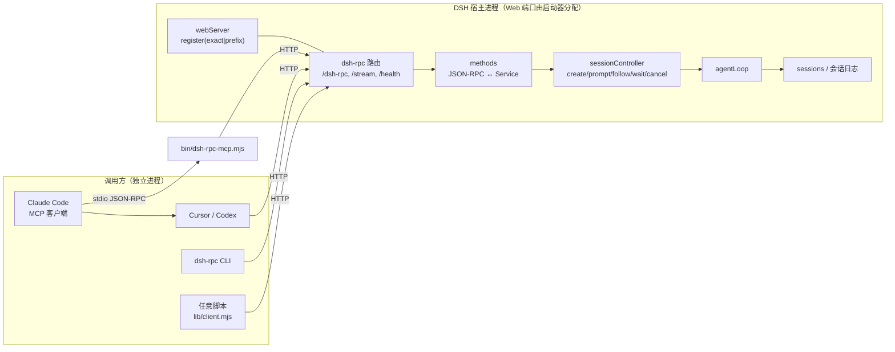
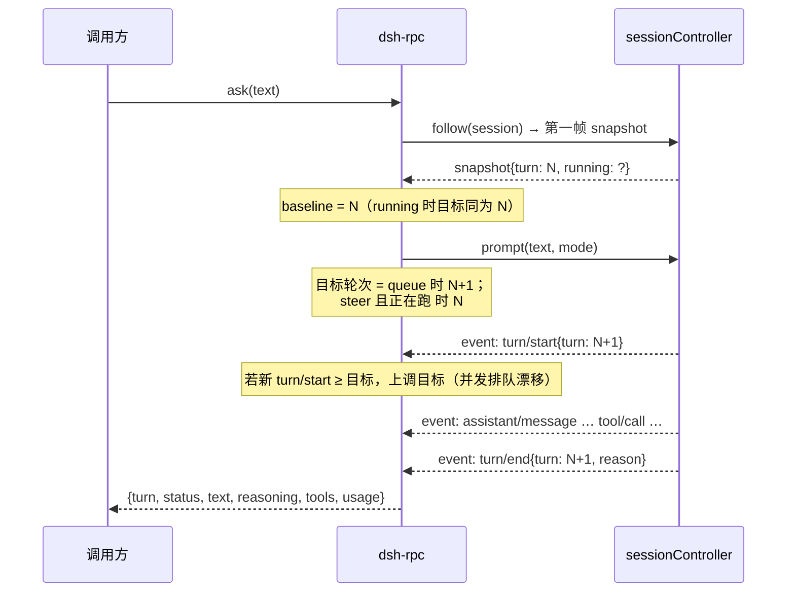

# dsh-rpc 设计说明

面向的读者：要改这个插件、或要给别的宿主做同类桥接的人。记录**为什么这样做**、以及做的时候在宿主里撞到的具体契约。

---

## 1. 问题

DSH 是一个完整的 agent，但它只有两种被使用方式：人在 GUI/CLI 里用，或它自己去调用别人（MCP、工具）。反过来——**让别人调用 DSH**——没有出口。

目标：本机其它 agent（Claude Code、Cursor、Codex、脚本）能把任务交给 DSH，拿到 DSH 的最终回答，而 DSH 仍然是一个带工具/技能/沙箱/持续会话的 agent，不是一个裸模型。

非目标：远程多租户、跨机器部署、替代 GUI。

## 2. 为什么是插件，而不是旁挂进程

旁挂进程只有两条路：

1. 复刻 DSH 的 agent loop（把 `dsh-agent-loop` 当库用）——但 loop 需要 session store、持久化、工具注册、审批、沙箱、模型路由……等于重新装配半个宿主，而且和宿主的版本强耦合。
2. 驱动 GUI 的 `/api` 通道——那是给浏览器用的私有协议，带自己的信任与鉴权模型（`connection.admit` / `peer` / `remoteAccess`），对它编程等于依赖未公开的内部约定。

插件路线的收益是**直接拿到 Host 的 Service**：`sessionController` 已经实现了"创建会话 / 提交 prompt / 跟随事件流 / 取消"这一整套，而且和 GUI 共用同一份会话状态。所以插件只做两件事：**注册 HTTP 路由**，**把 HTTP 语义翻译成 Service 调用**。

## 3. 架构



组件与职责：

| 文件 | 职责 |
| --- | --- |
| `index.mjs` | cordis 插件入口：解析配置、准备 token、建 methods、注册路由、写 `endpoint.json` |
| `lib/methods.mjs` | 全部业务方法；**轮次追踪算法**在这里 |
| `lib/http.mjs` | 三条路由、鉴权、loopback 判定、body 上限、批量/通知、NDJSON |
| `lib/auth.mjs` | token 生成/读取/比对（sha256 + `timingSafeEqual`）、`endpoint.json` |
| `lib/protocol.mjs` | JSON-RPC 2.0 助手、错误码、Host `RemoteError` → 本地码的映射 |
| `lib/config.mjs` | 手写配置校验（不用 schemastery，保持零依赖） |
| `lib/client.mjs` | 出进程客户端（CLI 与 MCP 共用） |
| `bin/dsh-rpc.mjs` | 人用的 CLI |
| `bin/dsh-rpc-mcp.mjs` | MCP stdio 桥 |

## 4. 关键决策

### 4.1 复用 `ctx.webServer`，不自建 HTTP server

`webServer.register({kind, path, handler})` 把路由挂到 GUI 已经监听的那个端口上（端口号由 DSH 决定，见第 11 节）：

- 不用抢端口、不用管 TLS/证书、不用向用户解释"还有第二个端口"。
- 生命周期跟着插件走：`ctx.effect(() => () => dispose())` 注册的 disposer 会在插件卸载时摘掉路由。
- 代价：路由活在 GUI 的 origin 下，必须自己做鉴权（浏览器同源策略保护不了 loopback）。

### 4.2 用 `sessionController`，不直接用 `agentLoop`

`agentLoop.createAgent` 能造 agent，但**造出来的是裸 agent**：没有 session 日志落盘、没有 title、没有 GUI 可见性、没有 `remoteAccess` 过滤，拆卸顺序也要自己对齐 loop（`sessions` 的注释明确警告过这点）。

`sessionController` 是 GUI 的同一条路径，语义已经封好：

```ts
create(request: SessionCreateRequest): Promise<{sessionId, agentPreset?}>
prompt(request: SessionPromptRequest, signal: AbortSignal): Promise<{accepted: true}>
follow(request: SessionFollowRequest, signal): AsyncIterable<SessionFollowFrame>
cancel(request: {sessionId}): {accepted: true}
```

所以 RPC 调用产生的会话就是 GUI 里能看见的普通会话——可在界面里接着聊，也可以被 `dsh.sessions.list` 列出来。

### 4.3 轮次追踪：先看基线，再提交 prompt

RPC 的语义是"给我这一轮的结果"，但 Host 的 `prompt` 只是**投递**（`agent.followup` / `agent.steer`），没有返回值语义。要拿到某一轮的结果，必须自己把"投递"和"这一轮"对上。

做法：



几个必须处理的细节：

- **基线只认 snapshot 的第一帧**。`follow` 先给快照再给增量，快照里已经混着历史事件（实测一次 snapshot 里有 37 条记录，含 `permission/preset`、`sandbox/mode`、`session/title` 等与轮次无关的事件）。
- **猜测只是起点，认领才是判据**。起初目标轮次完全靠"基线 + 1"（steer 取基线），再靠 `turn/start` 的 turn ≥ 目标就上调来兜并发漂移——这条路在别人插队时会把**别人的那一轮**当成自己的答案（复审发现的高危项）。现在改为**认领**：投递 prompt 之后，从事件流里找 `user/message` 且 `data.source.rpcId === requestId` 的那条，它落在哪一轮就把目标改成哪一轮；在认领之前，任何 `turn/end` 都不算本次调用的结果（`wait` 没有 prompt，仍按"窗口内最后一轮"处理）。实测该 `rpcId` 由 Host 原样写进 `user/message.source`（`lib/index.js` 里 `source = {kind:'user', rpcId: request.requestId}`），而 `user/message` 事件不带 turn 字段——所以归属要靠"最近一次 `turn/start`"来锚定。
- **`steer` 落到当前轮次**。正在跑的时候 steer 会插进当前 step，不会产生新的 `turn/start`，因此锚点初始化为基线轮次本身。
- **只保留轮次作用域事件**，上限 4000 条，避免长会话把内存拖死。
- **超时不取消**。`timeout` 只表示"我没等到"，把选择权留给调用方（可再 `cancel`）。反过来说，`cancel` 之后 `status` 一定是 `aborted`——因为状态取自该轮自己的 `turn/end` 原因。
- **空闲会话的 `wait` 也要读原因**。早先的实现直接把"没在跑"当作 `completed`，会把上一轮被取消的会话误报成功；现在统一从 `turn/end` 的 `reason.kind` 取状态。
- **流提前结束要标 `partial`**。事件流没等到 `turn/end` 就 `done` 时，`text` 是半截；`status` 保持 `unknown`，同时 `partial:true`，避免调用方把片段当完整回答。

### 4.4 零依赖

`package.json` 里没有 `dependencies` / `peerDependencies`。原因不是洁癖，而是**装进 profile 的 bundle 不能依赖 peer 解析**：它的 `node_modules` 由宿主的 pnpm 管理，任何外部依赖都可能解析到宿主自己的版本树里，制造版本漂移。所有能力用 `node:` 内置模块实现（`http` 走 `webServer` 给的 req/res、`crypto` 做 token、`fetch` 做客户端）。

### 4.5 两套错误码对齐

Host 抛 `RemoteError(code, message, details)`（`isDSHRemoteError === true`），码是 `session/not-found`、`session/agent-busy` 这类字符串。RPC 侧把它们映射到 `-3200x` 段，同时把原始 `kind` 留在 `error.data` 里——调用方既能按数值分支，也能拿到宿主的原始语义。

### 4.6 鉴权

- token 32 字节随机 hex，落盘 0600，路径 `%USERPROFILE%\.dsh\dsh-rpc\token`。
- 比对用 `sha256` + `timingSafeEqual`，避免时序侧信道。
- **loopback 白名单**：`req.socket.remoteAddress ∈ {127.0.0.1, ::1, ::ffff:127.0.0.1}`，否则 403。这一层是防"浏览器里随手 fetch"——因为任何网页都能向本机回环端口发请求，token 才挡得住跨站调用，白名单则挡掉非本机来源。
- `/health` 故意免鉴权，只回插件版本与 `authenticated:false`，方便探活。

## 5. 撞到的宿主契约（踩坑记录）

这些是读源码 + 实跑才确认的，写下来给后来者省时间。

| 现象 | 真相 |
| --- | --- |
| `turnWindow.minMessages must be a positive safe integer no greater than maxMessages` | `SessionFollowRequest.turnWindow` 的 `minMessages` 必须 ≥1；`{minMessages:0}` 非法。本插件干脆不传 `turnWindow`，只用 `maxMessages` |
| `Cannot read properties of undefined (reading 'throwIfAborted')` | `SessionController.prompt(request, signal)` / `list(_request, signal)` 会**无条件** `signal.throwIfAborted()`。一次性的调用也必须传一个真实 `AbortSignal`，不能传 `undefined` |
| Host 侧 `cancel` 不抛异常 | `agent.cancel(cause, {keepInbox:true})` 只做 `inbox.clear()` + `phase.abort.abort(cause)`；`SessionController.cancel(request)` 只有一个参数 |
| `follow` 的迭代器在 abort 时**正常结束**而不是抛错 | 所以"是否超时"只能由自己的 deadline 决定，不能靠 catch 分支 |
| 改了 `lib/*.mjs` 但行为不变 | 宿主 import 过就不再看文件。`plugin_manager` 把该行 `set_plugin(enabled:false)` 再 `true`，会重新 import（`application: "applied"`），无需重启 Harness |
| `cordis_inspect_query` 查配置要传 `{name:"@punchact/dsh-rpc"}`，查服务要传 `{service:"webServer"}` | Service provider 的入参键是 `service`，Config provider 才是 `name`；`additionalProperties:false`，传错直接被拒 |
| 插件行 `status: "absent"` | 正常。插件不导出 `Config` schema，所以没有可校验的 config 契约 |
| `node --test test/` 报 `spawn EPERM` | DSH 沙箱禁掉 Node 子进程的管道 stdio。单元测试要 `node test/methods.test.mjs` 在进程内跑 |

另外：发行包里的 `.d.ts` 已被裁掉，`lib/types/*.d.ts` 读不到；类型只能从 `lib/index.js` 的 `//#region lib/types/...` 分区注释与 JSDoc 反推。`app.asar` 也不能被 `ls`/`rg`/`node fs` 直接读串——需要按 asar 头格式解出（`_tmp/asar-get.mjs` 就是这么来的）。

## 6. 没选的方案

| 方案 | 为什么没选 |
| --- | --- |
| WebSocket / gRPC | JSON-RPC over HTTP 已经够用；NDJSON 流式同样简单，且任何语言、任何 agent 都能拼出请求体 |
| 直接暴露 GUI 的 `/api` | 私有协议 + 独立信任模型，属于未公开契约 |
| 一个 RPC 方法对应 Host 的全部 40+ 方法 | 暴露面越大越难保证语义正确；先覆盖"跑一轮、拿结果"闭环，其余按需加 |
| 把 token 放环境变量 | 环境变量会随子进程扩散；文件 + 显式 env 覆盖（`DSH_RPC_TOKEN`）更可控 |
| 进程内直调（同进程 import） | 调用方本来就是别的进程 |

## 7. 验证矩阵

| 层 | 手段 | 结果 |
| --- | --- | --- |
| 单元 | `test/methods.test.mjs`，37 例，Host 假体（含 follow 流与事件总线、必需 signal 的断言、`user/message` 认领、可选服务 `ctx.get` 注入） | 37/37 |
| 客户端 | `test/client.test.mjs`，6 例，临时 `$DSH_HOME` + 本地假服务（重试一次且不重放、`ECONNRESET` 不重试、显式 url 不重试、重试后的非连接失败保持原义、过期端点报错含 `pid`），外加一例对 `lib/transport.mjs` 钉住各平台的 errno 形状 | 6/6 |
| 状态页 | `test/status.test.mjs`，6 例，`/status` 载荷与路由寄生单元的接管/回滚 | 6/6 |
| 端到端 | `test/e2e.mjs`，14 项，走真实 `lib/client.mjs` | 14/14 |
| 边界 | `test/edge.mjs`，24 项协议对抗（batch、通知、超大 body、参数注入、超时钳制、并发、`limit` 语义） | 24/24 |
| 传输 | 401 / 403 / 413 / -32601 / -32602 / health 免鉴权 | 通过 |
| 语义 | ask 单轮、同会话续聊记住上文、history 只读、流式帧、取消活动轮次 → `aborted`、空闲 wait 取原因、并发 ask → `-32004`、别人插话时认领自己的轮次（实跑：`prompt` 抢跑一轮，`ask` 正确返回 turn 2 自己的答案） | 通过 |
| 接入 | MCP `initialize` / `tools/list` / `dsh_ask` / `dsh_status`（stdio 实跑） | 通过 |
| 稳定性 | 端点被改为死端口后 `ping` 退出码 3 且报错含 `nothing is listening`/`pid`/`health --wait`；恢复后立即正常（2026-11-05 实跑） | 通过 |

以上数字均为 2026-11-05 在本机实跑，命令见 README §10。

## 8. 后续可做

- `dsh.sessions.fork` / `rename` / `projections` 的薄封装。
- 把 `tools/call` 级别的进度也流到 MCP 的 `notifications/progress`，让上层 agent 看到 DSH 正在做什么。
- 可选的请求日志（`logRequests`）输出到宿主 logger，便于审计谁调用了 DSH。
- 若需要局域网调用：`allowRemote` + 反向代理终结 TLS，token 走 `Authorization` 头（不要放 query）。

## 9. 审查记录（2026-11-05）

首次交付后做了一轮"缺陷 + 官方规范"复审，以下是**实测确认**并已修复的问题。每条都保留了复现方式，便于回归。

| 严重度 | 问题 | 原因 | 复现 | 修法 |
| --- | --- | --- | --- | --- |
| 高 | 超大 body 时客户端只看到 `ECONNRESET`，413 永远发不出去 | `readBody` 一超限就 `req.destroy()`，响应写不进去 | 发 2MB body（`maxBodyBytes` 1MB） | 先排空再应答：超限只标记 overflow，超过 4 倍才断连；handler 按 `tooLarge` 回 **413 + `connection: close`** |
| 高 | JSON 调用方能注入内部通道 `params.signal` / `params.onEvent` | 驱动选项和方法参数塞在同一个对象里 | 传 `{"signal":"boom"}` → `signal.addEventListener is not a function` | 拆出第二参数 `internalContext(context)`，HTTP 层用 `methods.ask(params, {signal, onEvent})` 传 |
| 中 | 同一会话并发 `ask` 可能返回别人的轮次 | 两者都算 `baseline + 1`，撞同一个目标轮次 | 并发两个 ask（原先靠时序侥幸正确） | `prompting` Map 登记"谁在等轮次"，第二个提问型运行直接 `-32004`；`wait` 不拦 |
| 中 | `create` 无条件传 `process.cwd()`，覆盖宿主默认 | Host 的 `cwd = workspace?.path ?? request.cwd ?? defaultCwd`，defaultCwd 本就是 `process.cwd()` | `create {}` / `create {cwd:""}` 都落到 `…\.dsh\profiles\desktop` | 只在调用方真给了 cwd 时才写进 request；结果用 Host `inspect().meta.cwd` 回读 |
| 中 | Host 错误码映射只有 9 条，`agent-preset/not-found` 等落成 `-32000` | 映射表不全 | `ask` 带不存在的 preset | 扩到 17 条（含 `workspace/not-found`、`subagent/*`、`session/conflict`、`session/steer-unavailable`…） |
| 中 | CLI 的 `process.exit()` 截断管道 stdout | 未等待 drain 就退出 | `dsh-rpc ask … \| jq` | `flushStdio()` 在退出前 await |
| 中 | CLI `health` / `env` 不读 `endpoint.json`，跨端口时会探错地方 | 只用 `DSH_WEB_URL` 拼地址 | 换了端口后 `health` 探旧地址 | 两个命令都走 `readEndpoint()` 发现，`--url` 仍最高优先 |
| 中 | `rpcCall` 无默认超时，宿主卡住会把调用方一起挂死 | 只靠 `fetch` 自身 | 模拟宿主不响应 | 默认 2 分钟 `DEFAULT_CALL_TIMEOUT_MS`，并按错误类型给出退出码 3（连不上）/1（失败） |
| 中 | MCP 桥 `track()` 返回的 promise 无人接管 | `work.finally()` 的新 promise 悬空 | 上游拒绝时未处理拒绝可杀进程 | `work.catch(log).finally(...)` 真正被接管 |
| 中 | MCP 桥对 notification 也回帧 | 未判 `id` | 发 `tools/call` 不带 id | `if (!isNotification) reply(...)` |
| 低 | token 文件里的值不校验最短长度 | 只在 config/env 分支校验 | 手工写入短 token | 文件分支同样按 `MIN_TOKEN_LENGTH` 拒绝并提示删除重生成 |
| 低 | `endpoint.json` 非原子写 | 直接 `writeFileSync` | 恰好并发读取时可能读到半截 | 写 `${target}.${pid}.tmp` 再 `renameSync` |
| 低 | `path` 配置不拒绝 `..` 段 | 只做了前缀与尾部归一 | `path: "/dsh-rpc/../../etc"` | 显式拒绝 `.`/`..` 段 |

**规范符合性**（对照 `cordis-plugin-development` 的 `host-plugin.md` / `practices.md` / `verification.md`）：

- 满足：bundle manifest、`cordis.patch.yml` 插入行、`apply(ctx, config)` 形态、所需资源全部经 `ctx.effect` 注册并返回 cleanup、可选服务走 `inject`、显示元数据（`locale/*.json` 的 `meta.title`/`meta.description`）、`exports` 提供 `./locale/*.json` 与 `./icon`、图标在包内且 SVG ≤256KiB、等待持久事件 `turn/end` 而非轮询状态、不向 session 追加自定义事件类型。
- **明确偏差（已记录、可接受）**：未导出 `Config` schema。`practices.md` 建议可调参数放进 `Config` 以便用户改；本插件改为读 row 的 `config` 并手写校验，理由是零依赖——装进 profile 的 bundle 不应该依赖 `schemastery` 的 peer 解析。代价：`cordis_inspect_query` 里这行 `status: absent`，没有可视化表单。若将来接受一个 peer 依赖，可以补上 `export const Config` 而不改其它代码。
- 渲染核验：按 `verification.md` 的要求需要浏览器侧确认。**2026-11-05 已由用户在现场目视确认**：Plugins 页里该插件的行显示为 `RPC Bridge`，图标正常渲染 → `locale/*.json` 的 `meta.title` 确实被前台采用，`icon.svg` 渲染通过。
  - 仍存的边界：`meta.description`（locale 里的描述文案）未单独目视确认；`plugin_manager list_bundles` 输出里的 description 来自 `package.json` 的 `description` 字段，**与前台显示是两条通路**，不能互相代替取证。

## 10. 第二轮复盘（2026-11-05，独立复核后）

这一轮由外部独立审计方（只读，未改文件、未重载、未重启）对 `drive()` / `readBody()` / 协议边界做了对抗性复核，加上自查与实跑探针。**六条发现里五条成立**，逐条落地如下。

| 严重度 | 发现 | 判定 | 处置 |
| --- | --- | --- | --- |
| 高 | 目标轮次被更高轮次无约束抬高，可能把别人的轮次当成本次 `ask` 的结果 | 成立。原 `turn >= targetTurn` 的无条件上调在"别人先插话"时会把对方那一轮认成自己的 | 改为按 `user/message.source.rpcId` **认领**（见 4.3）；认领前任何 `turn/end` 都不接受，`turn/start` 只在"尚未认领 + 未产出正文 + 恰好 +1"时才容忍一次漂移 |
| 高 | 流未等到 `turn/end` 正常结束时，结果报 `unknown` 却带半截正文 | 部分成立：`unknown` 本身是诚实的，缺的是"这段正文不完整"的显式信号 | 结果新增 `partial: true`（仅当 `status === "unknown"` 且未超时）；README 说明"不要把 `partial` 的 `text` 当完整回答" |
| 中 | 并发上限按 session 计数，同会话多个 `wait` 互相覆盖，`activeRuns` 漏报 | 成立。`runs` 以 `sessionId` 为键，同会话后一个 run 会覆盖前一个 | `runs` 改为以 `runId` 为键（记录 `sessionId`），`activeRuns` 逐 run 输出；`prompting` 仍按 session 拦提问型并发 |
| 中 | `wait` 依赖有限快照，截断后可能误报 `idle`/`completed` 或丢掉 `aborted` | 成立，属真实边界 | 不掩盖：写入 README「已知边界」，并提示用 `history` 复核精确状态 |
| 低 | batch 内全部串行，一条慢 `ask` 阻塞后续请求 | 成立，但是**设计选择**（批量语义可预期、避免同一会话并发争抢） | 保留，写入 README「已知边界」 |
| 低 | 流式 handler 在方法抛错后仍走 `finally res.end()`，可能操作已关闭的响应 | 不成立/不可复现：`write()` 有 `writableEnded` 守卫，`res.end()` 包在 try/catch 内 | 不改，仅记录 |

同轮自查新增两处加固（未被审计方提出）：

- `drive()` 里"把调用方 signal 接到 `ac`"的代码原本在 `prompting.set(...)` 之后、`try` 之前——若它抛错，session 会永久被标成 busy。已整块移入 `try`，让 `finally` 一定清理。
- `client.mjs` 收到非 JSON 响应时给出可读诊断（"bridge is most likely not mounted…"），而不是 `Unexpected token '<'`——插件被禁用时 Web 服务仍会回 SPA 的 `index.html`。
- `limit` 语义统一：非正整数（`0`、`-1`、`2.5`、`"5"`）一律 `-32602`，不再被 `Math.max(1, …)` 悄悄改成 1 条。

**回归证据**：单元 21/21（新增"别人的轮次不被当成本次答案""并发上限按 run 计数""非法 limit 被拒"）、对抗 24/24（新增"小数 limit 被拒""显式 limit 仍生效"）、端到端 14/14；13 个 `.mjs` 全部 `node --check` 通过。

**本轮的更正记录（保留错误原文，不静默删除）**

- 错误原文：第一轮复审汇报里说过"`locale` 里的 `meta.title`/`meta.description` 已经出现在 bundle 列表里了"。
- 实测推翻：`plugin_manager list_bundles` 返回的 description 逐字等于 `package.json` 的 `description`；而 `locale/en.json` 的 title 是 `RPC Bridge`、`zh.json` 是 `RPC 桥接`，这两个串在该接口输出里根本没有出现。
- 真实根因：把"接口输出里有个像标题的字段"直接等价成"locale 的 meta 生效了"，中间缺一步字段来源核对——典型的计数型断言量错对象。
- 正确表述：`list_bundles` 显示的是包的 `description`；`locale` 的 `meta` 是否被前台采用，只能靠界面核验（已由用户于 2026-11-05 确认 title 与图标生效）。

---

## 11. 端口与连接稳定性（2026-11-05）

**问题**：DSH 的 Web 端口不固定。`dsh-web-app/cordis.patch.yml` 里 webserver 行是

```yaml
host: !!js ctx.webStartup.host ?? '127.0.0.1'
port: !!js ctx.webStartup.port ?? 3080
tls: !!js ctx.webStartup.tls
compression: gzip
```

桌面启动器传入 `port: 0`（交给系统分配），于是每次重启端口都变。任何"写死端口"的文档、配置或客户端都会在重启后失真。

**决策一：不固定端口。** 曾考虑在该行覆写 `port: 9527`，放弃的理由：

1. `cordis.patch.yml` 的覆写是**整行 config 替换**，写死 port 就要把 `host`/`tls`/`compression`/`compressionLevel`/`compressionThresholdBytes` 全部重述——官方升级增删键时会静默丢失行为。
2. 固定端口后，端口被占则 DSH 起不来，也失去多实例能力。
3. 代价只是"客户端要知道当前端口"，而这可以自动化。

**决策二：`endpoint.json` 是端点的唯一真相源。** 插件每次激活调用 `ctx.webServer.getOrigin()`（绑定前会抛错，故失败时回落到 `ctx.on('ready')` 重试），把结果连同 `pid`、`startedAt`、`updatedAt` 一起原子写入（写 `${target}.${pid}.tmp` 再 `renameSync`）。客户端**每次调用都重新读**，不缓存：

- `lib/client.mjs` 的 `rpcCall` / `rpcStream` 在每次调用入口解析连接；
- `readEndpoint()` 不缓存结果；
- CLI 的 `health` / `env` 也走这个文件，而不是 `DSH_WEB_URL`。

**决策三：只对"连接没建立"重试一次。** `ECONNREFUSED` 表示 TCP 握手被拒、请求没发出去，重试不会重复投递；`ECONNRESET`/`EPIPE`/超时可能意味着 prompt 已被收下并在跑，重发会造成重复轮次，因此只报错不重试。显式 `--url`/`DSH_RPC_URL` 不重试——调用方指定了地址，答案就是那个错误。

**决策四：`pid` + `startedAt` 让失败可归因。** 客户端重试后仍失败时，报错会带上"最后一次发布的时间与进程身份"，从而区分"Harness 换了端口"与"插件没在工作"。

**决策五：只有"连接被拒"才改写成端口漂移的说明。** 重试之后的失败若仍是 `ECONNREFUSED`，才包装成"没人监听 + 建议 `health --wait`"；若换到了新地址却拿到 401/方法错误/超时，那是请求本身的答案，原样抛出。否则读者会去查一个并不存在的重启。

**决策六：`health --wait` 的每次探测都受剩余预算约束。** 否则地址接受连接却不应答时，要靠 undici 的 300s 头超时才返回，`--wait 5000` 会变成几分钟。单发探查另有 5s 上限。

**已知残余风险**

- 插件尚未激活的启动窗口内，`endpoint.json` 还是上一次的内容（`pid` 是旧的、端口已失效），客户端重试一次后仍会失败——这是有意的：宁可报错，也不去猜。
- `endpoint.json` 是单文件，同时跑两个 Harness 时后启动的会覆盖前一个；多实例场景请用 `--url` 显式指定。

**验证**：`test/client.test.mjs` 六项——端点重发后重试成功且只投递一次、`ECONNRESET` 不重试（连接计数为 1）、显式 `--url` 不重试、重试后的 401 不被改写成"没人监听"、端点未变时报错含 `pid` 与 `health --wait` 提示，外加一例对 `lib/transport.mjs` 钉住各平台 errno 形状。

## 12. 设置页状态面板与路由挂载（2026-11-05）

需求是"人机交互里能看到桥的当前状态"，所以做成 DSH 设置里的一个页面，而不是再加一条 CLI 命令。

**为什么另开 `/status` 而不复用 `/health`。** `/health` 存在的意义是"进程活着"，一个字节都不该多给；面板要的是运行时长、`pid`、凭据来源、在跑的轮次、最近调用与聚合计数。把两者合并会让健康检查变成一份信息面更大的接口。

**为什么 `/status` 不要 token。** 页面是静态浏览器模块，它拿不到 `endpoint.json`（那是 Node 侧文件），因此不可能自带 token。可选方案是让页面把 token 存进 `localStorage`，那等于把"驱动 DSH"的凭据放进一个可被任何同源脚本读到的地方——比"免 token 但只说聚合事实"更糟。于是 `/status` 与 `/health` 共用同一条边界：**只接受 loopback**，并靠"不说"来保护内容：

- 不返回 token、不返回 `sessionId`（在跑的轮次只给运行 ID 前 8 位与"是否有会话"）；
- 调用记账只存**方法名、耗时、结果码**，不存参数（`lib/stats.mjs` 的注释写明了理由）。

**决策七：路由挂载用"寄生单元"，而不是直接 `register`。** 宿主的 `webServer` 只有 `register` 与其返回的 disposer，没有 unregister；而 Cordis 每次重载都会**重新 import 模块**，模块级状态全部重置。直接 `register` 会有两个后果：

1. 上一代因异常没走完 cleanup，路由留在进程里，下一代 `register` 撞 `duplicate exact route`，此后**再也激活不了**（本次实测踩到：一个 `if` 写错导致同一路径挂两次，抛错发生在 `ctx.effect` 之前，四条路由全部泄漏，行状态卡在 `failed`）。
2. 反过来，若下一代"继承"上一代的路由却不持有 disposer，那么停用插件也不会真正下线。

做法：`globalThis[Symbol.for("dsh-rpc.route-cells")]` 上放一张 `path → {handler, owner, release}` 表（用 `globalThis` 而不是模块变量，正是为了跨"重新 import"存活）。每个路径只 `register` 一次一个 trampoline，`claim()` 把 `handler`/`owner` 指向最新一代；**接管的一代也会得到自己的 disposer**，卸载时只有"当前属主"才真正调用 `release()`。

**决策八：挂载是原子的。** 挂载整段包在 `try/catch` 里，任一 `register` 抛错就把已挂的全部回滚再抛。否则会出现"路由挂了一半、行报失败"的分裂状态——比彻底失败更难判断。

**已知残余风险**：本设计能防"未来的重载"，但**无法回收已经泄漏在同一进程里的路由**（`webServer` 没有反注册 API，disposer 只存在于当年那份闭包里）。遇到这种情况只能重启 DSH 让路由表重建。

**验证**：`test/status.test.mjs` 六项——载荷只含聚合数据（断言 token、`sessionId`、prompt 正文都不出现）、非 loopback 403、非 GET/HEAD 405、`stats` 只记四个字段、同进程第二代接管而不撞车且只有当前属主能卸载、挂载中途失败整段回滚。

## 13. 工作区、模型、推理等级、权限（2026-11-05）

需求是把 DSH 当子智能体用：外部 agent 应当能像人一样先看有哪些工作区、指定一个进去，并且能安排这一轮用哪个模型、什么推理强度、什么权限。

**决策九：位置用 Host 的 `workspaceId`，不用"自己记一份目录"。** 会话归属工作区靠 `workspace.attachSession`（`SessionCommandController.create` 内部调用），它同时决定目录与侧栏归属；`cwd` 只决定目录。所以两者做成互斥参数，都只在创建时生效。宿主对"同时给 workspaceId 与 cwd"本身就是报错（`session.create accepts workspaceId or cwd, not both`），桥在本地先拦一次，让调用方拿到可读的 `-32602` 而不是 Host 的错误文案。

**决策十：模型/推理/权限在创建之后用 Host 的 setter 安装，不塞进 create 请求。** 三者都属于 Session 而不是 CreateRequest（`selectModel` 的入参就是 `{sessionId, provider, model, reasoningEffort?}`）。因此 `createSession` 内部的顺序是"先 create，再 `applySessionOptions`"，`ask` 在复用会话时同样先应用再投 prompt。

**决策十一：裸模型 id 只在无歧义时接受。** `resolveModel` 先看有没有 `/`；没有就去 `modelCatalog().groups` 里按 `entry.id === model` 找，唯一命中才用。多个 provider 都提供同名模型时报错并给出 `provider/model` 的写法——静默选一个等于把这一轮送到调用方没指定的供应商。零命中指向 `dsh.models`。

**决策十二：`reasoningEffort` 必须配 `model`。** Host 的 setter 收的是完整 selection，而"读回会话当前模型"没有公开接口。于是只有 effort 没有 model 时直接拒绝，而不是猜一个模型或悄悄忽略 effort。

**决策十三：`permissionPreset` 先按 Host catalog 白名单校验，再落到活 Session 上。** `permissionPresets.set(session, name)` 要的是活的 `Session` 对象而不是 id：先 `ctx.get("sessions").get(id)`，冷会话时用 `resolveAgent` 走一遍 admission（与 `prompt` 同一条路径）再取。服务缺失时返回 `-32000` 并说明"本部署没有 permissionPresets 服务"，不静默跳过。

**决策十四：CLI 与 MCP 不预筛创建期参数，一律转发、由桥拒绝。** 最初 `runAsk` 与 `dsh_ask` 在给了会话时"不转发位置参数"，本意是省一次往返，实测代价是**参数被静默丢弃**：`ask --session X --workspace Y` 照常跑了一轮（exit 0），调用方以为进了工作区。现在两边都无条件转发，由 `ask` 里唯一的守卫给出统一文案（`workspaceId`/`cwd`/`agentPreset` 三者都是创建期决定）。教训：客户端做的"善意过滤"会把矛盾藏起来，而矛盾正是调用方需要看到的。

**已知副作用（文档化而非隐藏）**：`selectModel` 在宿主内部还会把选择存成 profile 默认。也就是说外部 agent 换模型之后，用户下次在 GUI 新开会话也会用那个模型。这是 Host 对"模型切换"的既有语义，桥不额外改它，但必须在 README 里写明。

**刻意没做**：`workspaces.delete` / `workspaces.rename` 不暴露。侧栏条目属于用户的空间，外部 agent 误删的代价远大于省下的一次点击。

**验证**：`test/methods.test.mjs` 新增 16 例覆盖上述全部拒绝路径与两条正常工作路径（workspaceId 转发而不带 cwd、workspace 与 cwd 同时出现被拒、裸 id 唯一/歧义/未知、effort 缺 model、未知 preset、服务缺失、workspace 列表的 `missing-dir` 降级、按路径注册、复用会话拒绝位置参数、ask 把 selected/permissionPreset 并入结果）。


