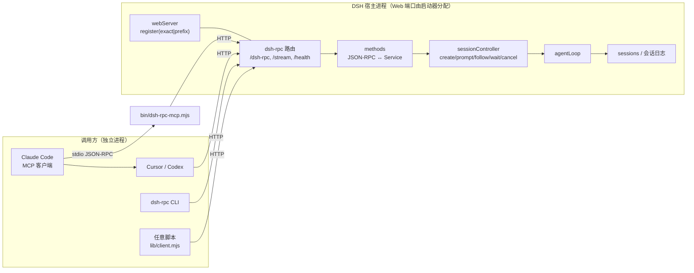
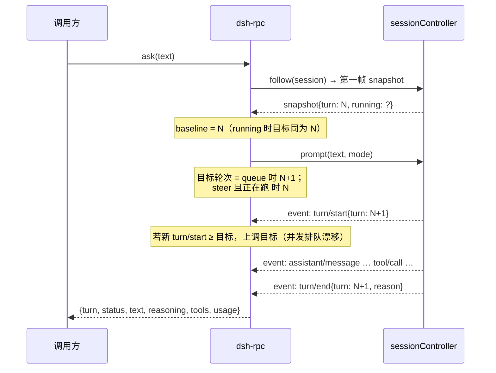

# dsh-rpc 设计说明

面向的读者：要改这个插件、或要给别的宿主做同类桥接的人。记录**为什么这样做**、以及做的时候在宿主里撞到的具体契约。

---

## 1. 问题

DSH 是一个完整的 agent，但它只有两种被使用方式：人在 GUI/CLI 里用，或它自己去调用别人（MCP、工具）。反过来——**让别人调用 DSH**——没有出口。

目标：本机其它 agent（Claude Code、Cursor、Codex、脚本）能把任务交给 DSH，拿到 DSH 的最终回答，而 DSH 仍然是一个带工具/技能/沙箱/持续会话的 agent，不是一个裸模型。

非目标：远程多租户、跨机器部署、替代 GUI。

## 2. 为什么是插件，而不是旁挂进程

旁挂进程只有两条路：

1. 复刻 DSH 的 agent loop（把 `dsh-agent-loop` 当库用）——但 loop 需要 session store、持久化、工具注册、审批、沙箱、模型路由……等于重新装配半个宿主，而且和宿主的版本强耦合。
2. 驱动 GUI 的 `/api` 通道——那是给浏览器用的私有协议，带自己的信任与鉴权模型（`connection.admit` / `peer` / `remoteAccess`），对它编程等于依赖未公开的内部约定。

插件路线的收益是**直接拿到 Host 的 Service**：`sessionController` 已经实现了"创建会话 / 提交 prompt / 跟随事件流 / 取消"这一整套，而且和 GUI 共用同一份会话状态。所以插件只做两件事：**注册 HTTP 路由**，**把 HTTP 语义翻译成 Service 调用**。

## 3. 架构



组件与职责：

| 文件 | 职责 |
| --- | --- |
| `index.mjs` | cordis 插件入口：解析配置、准备 token、建 methods、注册路由、写 `endpoint.json` |
| `lib/methods.mjs` | 全部业务方法；**轮次追踪算法**在这里 |
| `lib/http.mjs` | 三条路由、鉴权、loopback 判定、body 上限、批量/通知、NDJSON |
| `lib/auth.mjs` | token 生成/读取/比对（sha256 + `timingSafeEqual`）、`endpoint.json` |
| `lib/protocol.mjs` | JSON-RPC 2.0 助手、错误码、Host `RemoteError` → 本地码的映射 |
| `lib/config.mjs` | 手写配置校验（不用 schemastery，保持零依赖） |
| `lib/client.mjs` | 出进程客户端（CLI 与 MCP 共用） |
| `bin/dsh-rpc.mjs` | 人用的 CLI |
| `bin/dsh-rpc-mcp.mjs` | MCP stdio 桥 |

## 4. 关键决策

### 4.1 复用 `ctx.webServer`，不自建 HTTP server

`webServer.register({kind, path, handler})` 把路由挂到 GUI 已经监听的那个端口上（端口号由 DSH 决定，见第 11 节）：

- 不用抢端口、不用管 TLS/证书、不用向用户解释"还有第二个端口"。
- 生命周期跟着插件走：`ctx.effect(() => () => dispose())` 注册的 disposer 会在插件卸载时摘掉路由。
- 代价：路由活在 GUI 的 origin 下，必须自己做鉴权（浏览器同源策略保护不了 loopback）。

### 4.2 用 `sessionController`，不直接用 `agentLoop`

`agentLoop.createAgent` 能造 agent，但**造出来的是裸 agent**：没有 session 日志落盘、没有 title、没有 GUI 可见性、没有 `remoteAccess` 过滤，拆卸顺序也要自己对齐 loop（`sessions` 的注释明确警告过这点）。

`sessionController` 是 GUI 的同一条路径，语义已经封好：

```ts
create(request: SessionCreateRequest): Promise<{sessionId, agentPreset?}>
prompt(request: SessionPromptRequest, signal: AbortSignal): Promise<{accepted: true}>
follow(request: SessionFollowRequest, signal): AsyncIterable<SessionFollowFrame>
cancel(request: {sessionId}): {accepted: true}
```

所以 RPC 调用产生的会话就是 GUI 里能看见的普通会话——可在界面里接着聊，也可以被 `dsh.sessions.list` 列出来。

### 4.3 轮次追踪：先看基线，再提交 prompt

RPC 的语义是"给我这一轮的结果"，但 Host 的 `prompt` 只是**投递**（`agent.followup` / `agent.steer`），没有返回值语义。要拿到某一轮的结果，必须自己把"投递"和"这一轮"对上。

做法：



几个必须处理的细节：

- **基线只认 snapshot 的第一帧**。`follow` 先给快照再给增量，快照里已经混着历史事件（实测一次 snapshot 里有 37 条记录，含 `permission/preset`、`sandbox/mode`、`session/title` 等与轮次无关的事件）。
- **猜测只是起点，认领才是判据**。起初目标轮次完全靠"基线 + 1"（steer 取基线），再靠 `turn/start` 的 turn ≥ 目标就上调来兜并发漂移——这条路在别人插队时会把**别人的那一轮**当成自己的答案（复审发现的高危项）。现在改为**认领**：投递 prompt 之后，从事件流里找 `user/message` 且 `data.source.rpcId === requestId` 的那条，它落在哪一轮就把目标改成哪一轮；在认领之前，任何 `turn/end` 都不算本次调用的结果（`wait` 没有 prompt，仍按"窗口内最后一轮"处理）。实测该 `rpcId` 由 Host 原样写进 `user/message.source`（`lib/index.js` 里 `source = {kind:'user', rpcId: request.requestId}`），而 `user/message` 事件不带 turn 字段——所以归属要靠"最近一次 `turn/start`"来锚定。
- **`steer` 落到当前轮次**。正在跑的时候 steer 会插进当前 step，不会产生新的 `turn/start`，因此锚点初始化为基线轮次本身。
- **只保留轮次作用域事件**，上限 4000 条，避免长会话把内存拖死。
- **超时不取消**。`timeout` 只表示"我没等到"，把选择权留给调用方（可再 `cancel`）。反过来说，`cancel` 之后 `status` 一定是 `aborted`——因为状态取自该轮自己的 `turn/end` 原因。
- **空闲会话的 `wait` 也要读原因**。早先的实现直接把"没在跑"当作 `completed`，会把上一轮被取消的会话误报成功；现在统一从 `turn/end` 的 `reason.kind` 取状态。
- **流提前结束要标 `partial`**。事件流没等到 `turn/end` 就 `done` 时，`text` 是半截；`status` 保持 `unknown`，同时 `partial:true`，避免调用方把片段当完整回答。

### 4.4 零依赖

`package.json` 里没有 `dependencies` / `peerDependencies`。原因不是洁癖，而是**装进 profile 的 bundle 不能依赖 peer 解析**：它的 `node_modules` 由宿主的 pnpm 管理，任何外部依赖都可能解析到宿主自己的版本树里，制造版本漂移。所有能力用 `node:` 内置模块实现（`http` 走 `webServer` 给的 req/res、`crypto` 做 token、`fetch` 做客户端）。

### 4.5 两套错误码对齐

Host 抛 `RemoteError(code, message, details)`（`isDSHRemoteError === true`），码是 `session/not-found`、`session/agent-busy` 这类字符串。RPC 侧把它们映射到 `-3200x` 段，同时把原始 `kind` 留在 `error.data` 里——调用方既能按数值分支，也能拿到宿主的原始语义。

### 4.6 鉴权

- token 32 字节随机 hex，落盘 0600，路径 `%USERPROFILE%\.dsh\dsh-rpc\token`。
- 比对用 `sha256` + `timingSafeEqual`，避免时序侧信道。
- **loopback 白名单**：`req.socket.remoteAddress ∈ {127.0.0.1, ::1, ::ffff:127.0.0.1}`，否则 403。这一层是防"浏览器里随手 fetch"——因为任何网页都能向本机回环端口发请求，token 才挡得住跨站调用，白名单则挡掉非本机来源。
- `/health` 故意免鉴权，只回插件版本与 `authenticated:false`，方便探活。

## 5. 撞到的宿主契约（踩坑记录）

这些是读源码 + 实跑才确认的，写下来给后来者省时间。

| 现象 | 真相 |
| --- | --- |
| `turnWindow.minMessages must be a positive safe integer no greater than maxMessages` | `SessionFollowRequest.turnWindow` 的 `minMessages` 必须 ≥1；`{minMessages:0}` 非法。本插件干脆不传 `turnWindow`，只用 `maxMessages` |
| `Cannot read properties of undefined (reading 'throwIfAborted')` | `SessionController.prompt(request, signal)` / `list(_request, signal)` 会**无条件** `signal.throwIfAborted()`。一次性的调用也必须传一个真实 `AbortSignal`，不能传 `undefined` |
| Host 侧 `cancel` 不抛异常 | `agent.cancel(cause, {keepInbox:true})` 只做 `inbox.clear()` + `phase.abort.abort(cause)`；`SessionController.cancel(request)` 只有一个参数 |
| `follow` 的迭代器在 abort 时**正常结束**而不是抛错 | 所以"是否超时"只能由自己的 deadline 决定，不能靠 catch 分支 |
| 改了 `lib/*.mjs` 但行为不变 | 宿主 import 过就不再看文件。`plugin_manager` 把该行 `set_plugin(enabled:false)` 再 `true`，会重新 import（`application: "applied"`），无需重启 Harness |
| `cordis_inspect_query` 查配置要传 `{name:"@punchact/dsh-rpc-agent"}`，查服务要传 `{service:"webServer"}` | Service provider 的入参键是 `service`，Config provider 才是 `name`；`additionalProperties:false`，传错直接被拒 |
| 插件行 `status: "absent"` | 正常。插件不导出 `Config` schema，所以没有可校验的 config 契约 |
| `node --test test/` 报 `spawn EPERM` | DSH 沙箱禁掉 Node 子进程的管道 stdio。单元测试要 `node test/methods.test.mjs` 在进程内跑 |

另外：发行包里的 `.d.ts` 已被裁掉，`lib/types/*.d.ts` 读不到；类型只能从 `lib/index.js` 的 `//#region lib/types/...` 分区注释与 JSDoc 反推。`app.asar` 也不能被 `ls`/`rg`/`node fs` 直接读串——需要按 asar 头格式解出（`_tmp/asar-get.mjs` 就是这么来的）。

## 6. 没选的方案

| 方案 | 为什么没选 |
| --- | --- |
| WebSocket / gRPC | JSON-RPC over HTTP 已经够用；NDJSON 流式同样简单，且任何语言、任何 agent 都能拼出请求体 |
| 直接暴露 GUI 的 `/api` | 私有协议 + 独立信任模型，属于未公开契约 |
| 一个 RPC 方法对应 Host 的全部 40+ 方法 | 暴露面越大越难保证语义正确；先覆盖"跑一轮、拿结果"闭环，其余按需加 |
| 把 token 放环境变量 | 环境变量会随子进程扩散；文件 + 显式 env 覆盖（`DSH_RPC_TOKEN`）更可控 |
| 进程内直调（同进程 import） | 调用方本来就是别的进程 |

## 7. 验证矩阵

| 层 | 手段 | 结果 |
| --- | --- | --- |
| 单元 | `test/methods.test.mjs`，41 例，Host 假体（含 follow 流与事件总线、必需 signal 的断言、`user/message` 认领、可选服务 `ctx.get` 注入） | 41/41 |
| 真宿主 | `test/host.test.mjs`，1 例，进程内起真实 `@deepseek-ai/dsh-host-webserver`（`port: 0`），断言挂载、鉴权、`/status` 与 `disposeEffects()` 后路由 404 | 1/1 |
| 客户端 | `test/client.test.mjs`，6 例，临时 `$DSH_HOME` + 本地假服务（重试一次且不重放、`ECONNRESET` 不重试、显式 url 不重试、重试后的非连接失败保持原义、过期端点报错含 `pid`），外加一例对 `lib/transport.mjs` 钉住各平台的 errno 形状 | 6/6 |
| 状态页 | `test/status.test.mjs`，6 例，`/status` 载荷与路由寄生单元的接管/回滚 | 6/6 |
| 端到端 | `test/e2e.mjs`，14 项，走真实 `lib/client.mjs` | 14/14 |
| 边界 | `test/edge.mjs`，24 项协议对抗（batch、通知、超大 body、参数注入、超时钳制、并发、`limit` 语义） | 24/24 |
| 传输 | 401 / 403 / 413 / -32601 / -32602 / health 免鉴权 | 通过 |
| 语义 | ask 单轮、同会话续聊记住上文、history 只读、流式帧、取消活动轮次 → `aborted`、空闲 wait 取原因、并发 ask → `-32004`、别人插话时认领自己的轮次（实跑：`prompt` 抢跑一轮，`ask` 正确返回 turn 2 自己的答案） | 通过 |
| 接入 | MCP `initialize` / `tools/list` / `dsh_ask` / `dsh_status`（stdio 实跑） | 通过 |
| 稳定性 | 端点被改为死端口后 `ping` 退出码 3 且报错含 `nothing is listening`/`pid`/`health --wait`；恢复后立即正常（2026-11-05 实跑） | 通过 |

以上数字均为 2026-11-05 在本机实跑，命令见 README §10。

> **现行口径（2026-11-19，0.9.3）**：本表是 2026-11-05 的历史快照，不改写。当前的数量以 README「开发与验证」为准——`npm test` 固定顺序跑 43 个 `*.test.mjs` 共 375 例，外加 `catalog.smoke.mjs`（34 个 RPC 方法）。表中三行随版本长大：`methods` 41 → 85 例，`client` 6 → 8 例；`edge` 仍是 24 项，但**本机 23/24**——第 21 项「create without a cwd reports the directory the Host attached」要求宿主替无 `cwd` 的请求补上工作目录，本机 0.8.1 宿主返回 `null`，属既有环境差异；**CI 不跑 `test:edge`（`.github/workflows/test.yml` 只有 `npm test` / `test:host` / `check:package`），故“CI 下通过”没有证据**，这一项目前只有本机 23/24 的实测。

## 8. 后续可做

- `dsh.sessions.fork` / `rename` / `projections` 的薄封装。
- 把 `tools/call` 级别的进度也流到 MCP 的 `notifications/progress`，让上层 agent 看到 DSH 正在做什么。
- 可选的请求日志（`logRequests`）输出到宿主 logger，便于审计谁调用了 DSH。
- 若需要局域网调用：`allowRemote` + 反向代理终结 TLS，token 走 `Authorization` 头（不要放 query）。

## 9. 审查记录（2026-11-05）

首次交付后做了一轮"缺陷 + 官方规范"复审，以下是**实测确认**并已修复的问题。每条都保留了复现方式，便于回归。

| 严重度 | 问题 | 原因 | 复现 | 修法 |
| --- | --- | --- | --- | --- |
| 高 | 超大 body 时客户端只看到 `ECONNRESET`，413 永远发不出去 | `readBody` 一超限就 `req.destroy()`，响应写不进去 | 发 2MB body（`maxBodyBytes` 1MB） | 先排空再应答：超限只标记 overflow，超过 4 倍才断连；handler 按 `tooLarge` 回 **413 + `connection: close`** |
| 高 | JSON 调用方能注入内部通道 `params.signal` / `params.onEvent` | 驱动选项和方法参数塞在同一个对象里 | 传 `{"signal":"boom"}` → `signal.addEventListener is not a function` | 拆出第二参数 `internalContext(context)`，HTTP 层用 `methods.ask(params, {signal, onEvent})` 传 |
| 中 | 同一会话并发 `ask` 可能返回别人的轮次 | 两者都算 `baseline + 1`，撞同一个目标轮次 | 并发两个 ask（原先靠时序侥幸正确） | `prompting` Map 登记"谁在等轮次"，第二个提问型运行直接 `-32004`；`wait` 不拦 |
| 中 | `create` 无条件传 `process.cwd()`，覆盖宿主默认 | Host 的 `cwd = workspace?.path ?? request.cwd ?? defaultCwd`，defaultCwd 本就是 `process.cwd()` | `create {}` / `create {cwd:""}` 都落到 `…\.dsh\profiles\desktop` | 只在调用方真给了 cwd 时才写进 request；结果用 Host `inspect().meta.cwd` 回读 |
| 中 | Host 错误码映射只有 9 条，`agent-preset/not-found` 等落成 `-32000` | 映射表不全 | `ask` 带不存在的 preset | 扩到 17 条（含 `workspace/not-found`、`subagent/*`、`session/conflict`、`session/steer-unavailable`…） |
| 中 | CLI 的 `process.exit()` 截断管道 stdout | 未等待 drain 就退出 | `dsh-rpc ask … \| jq` | `flushStdio()` 在退出前 await |
| 中 | CLI `health` / `env` 不读 `endpoint.json`，跨端口时会探错地方 | 只用 `DSH_WEB_URL` 拼地址 | 换了端口后 `health` 探旧地址 | 两个命令都走 `readEndpoint()` 发现，`--url` 仍最高优先 |
| 中 | `rpcCall` 无默认超时，宿主卡住会把调用方一起挂死 | 只靠 `fetch` 自身 | 模拟宿主不响应 | 默认 2 分钟 `DEFAULT_CALL_TIMEOUT_MS`，并按错误类型给出退出码 3（连不上）/1（失败） |
| 中 | MCP 桥 `track()` 返回的 promise 无人接管 | `work.finally()` 的新 promise 悬空 | 上游拒绝时未处理拒绝可杀进程 | `work.catch(log).finally(...)` 真正被接管 |
| 中 | MCP 桥对 notification 也回帧 | 未判 `id` | 发 `tools/call` 不带 id | `if (!isNotification) reply(...)` |
| 低 | token 文件里的值不校验最短长度 | 只在 config/env 分支校验 | 手工写入短 token | 文件分支同样按 `MIN_TOKEN_LENGTH` 拒绝并提示删除重生成 |
| 低 | `endpoint.json` 非原子写 | 直接 `writeFileSync` | 恰好并发读取时可能读到半截 | 写 `${target}.${pid}.tmp` 再 `renameSync` |
| 低 | `path` 配置不拒绝 `..` 段 | 只做了前缀与尾部归一 | `path: "/dsh-rpc/../../etc"` | 显式拒绝 `.`/`..` 段 |

**规范符合性**（对照 `cordis-plugin-development` 的 `host-plugin.md` / `practices.md` / `verification.md`）：

- 满足：bundle manifest、`cordis.patch.yml` 插入行、`apply(ctx, config)` 形态、所需资源全部经 `ctx.effect` 注册并返回 cleanup、可选服务走 `inject`、显示元数据（`locale/*.json` 的 `meta.title`/`meta.description`）、`exports` 提供 `./locale/*.json` 与 `./icon`、图标在包内且 SVG ≤256KiB、等待持久事件 `turn/end` 而非轮询状态、不向 session 追加自定义事件类型。
- **明确偏差（已记录、可接受）**：未导出 `Config` schema。`practices.md` 建议可调参数放进 `Config` 以便用户改；本插件改为读 row 的 `config` 并手写校验，理由是零依赖——装进 profile 的 bundle 不应该依赖 `schemastery` 的 peer 解析。代价：`cordis_inspect_query` 里这行 `status: absent`，没有可视化表单。若将来接受一个 peer 依赖，可以补上 `export const Config` 而不改其它代码。
- 渲染核验：按 `verification.md` 的要求需要浏览器侧确认。**2026-11-05 已由用户在现场目视确认**：Plugins 页里该插件的行显示为 `RPC Bridge`，图标正常渲染 → `locale/*.json` 的 `meta.title` 确实被前台采用，`icon.svg` 渲染通过。
  - 仍存的边界：`meta.description`（locale 里的描述文案）未单独目视确认；`plugin_manager list_bundles` 输出里的 description 来自 `package.json` 的 `description` 字段，**与前台显示是两条通路**，不能互相代替取证。

## 10. 第二轮复盘（2026-11-05，独立复核后）

这一轮由外部独立审计方（只读，未改文件、未重载、未重启）对 `drive()` / `readBody()` / 协议边界做了对抗性复核，加上自查与实跑探针。**六条发现里五条成立**，逐条落地如下。

| 严重度 | 发现 | 判定 | 处置 |
| --- | --- | --- | --- |
| 高 | 目标轮次被更高轮次无约束抬高，可能把别人的轮次当成本次 `ask` 的结果 | 成立。原 `turn >= targetTurn` 的无条件上调在"别人先插话"时会把对方那一轮认成自己的 | 改为按 `user/message.source.rpcId` **认领**（见 4.3）；认领前任何 `turn/end` 都不接受，`turn/start` 只在"尚未认领 + 未产出正文 + 恰好 +1"时才容忍一次漂移 |
| 高 | 流未等到 `turn/end` 正常结束时，结果报 `unknown` 却带半截正文 | 部分成立：`unknown` 本身是诚实的，缺的是"这段正文不完整"的显式信号 | 结果新增 `partial: true`（仅当 `status === "unknown"` 且未超时）；README 说明"不要把 `partial` 的 `text` 当完整回答" |
| 中 | 并发上限按 session 计数，同会话多个 `wait` 互相覆盖，`activeRuns` 漏报 | 成立。`runs` 以 `sessionId` 为键，同会话后一个 run 会覆盖前一个 | `runs` 改为以 `runId` 为键（记录 `sessionId`），`activeRuns` 逐 run 输出；`prompting` 仍按 session 拦提问型并发 |
| 中 | `wait` 依赖有限快照，截断后可能误报 `idle`/`completed` 或丢掉 `aborted` | 成立，属真实边界 | 不掩盖：写入 README「已知边界」，并提示用 `history` 复核精确状态 |
| 低 | batch 内全部串行，一条慢 `ask` 阻塞后续请求 | 成立，但是**设计选择**（批量语义可预期、避免同一会话并发争抢） | 保留，写入 README「已知边界」 |
| 低 | 流式 handler 在方法抛错后仍走 `finally res.end()`，可能操作已关闭的响应 | 不成立/不可复现：`write()` 有 `writableEnded` 守卫，`res.end()` 包在 try/catch 内 | 不改，仅记录 |

同轮自查新增两处加固（未被审计方提出）：

- `drive()` 里"把调用方 signal 接到 `ac`"的代码原本在 `prompting.set(...)` 之后、`try` 之前——若它抛错，session 会永久被标成 busy。已整块移入 `try`，让 `finally` 一定清理。
- `client.mjs` 收到非 JSON 响应时给出可读诊断（"bridge is most likely not mounted…"），而不是 `Unexpected token '<'`——插件被禁用时 Web 服务仍会回 SPA 的 `index.html`。
- `limit` 语义统一：非正整数（`0`、`-1`、`2.5`、`"5"`）一律 `-32602`，不再被 `Math.max(1, …)` 悄悄改成 1 条。

**回归证据**：单元 21/21（新增"别人的轮次不被当成本次答案""并发上限按 run 计数""非法 limit 被拒"）、对抗 24/24（新增"小数 limit 被拒""显式 limit 仍生效"）、端到端 14/14；13 个 `.mjs` 全部 `node --check` 通过。

**本轮的更正记录（保留错误原文，不静默删除）**

- 错误原文：第一轮复审汇报里说过"`locale` 里的 `meta.title`/`meta.description` 已经出现在 bundle 列表里了"。
- 实测推翻：`plugin_manager list_bundles` 返回的 description 逐字等于 `package.json` 的 `description`；而 `locale/en.json` 的 title 是 `RPC Bridge`、`zh.json` 是 `RPC 桥接`，这两个串在该接口输出里根本没有出现。
- 真实根因：把"接口输出里有个像标题的字段"直接等价成"locale 的 meta 生效了"，中间缺一步字段来源核对——典型的计数型断言量错对象。
- 正确表述：`list_bundles` 显示的是包的 `description`；`locale` 的 `meta` 是否被前台采用，只能靠界面核验（已由用户于 2026-11-05 确认 title 与图标生效）。

---

## 11. 端口与连接稳定性（2026-11-05）

**问题**：DSH 的 Web 端口不固定。`dsh-web-app/cordis.patch.yml` 里 webserver 行是

```yaml
host: !!js ctx.webStartup.host ?? '127.0.0.1'
port: !!js ctx.webStartup.port ?? 3080
tls: !!js ctx.webStartup.tls
compression: gzip
```

桌面启动器传入 `port: 0`（交给系统分配），于是每次重启端口都变。任何"写死端口"的文档、配置或客户端都会在重启后失真。

**决策一：不固定端口。** 曾考虑在该行覆写 `port: 9527`，放弃的理由：

1. `cordis.patch.yml` 的覆写是**整行 config 替换**，写死 port 就要把 `host`/`tls`/`compression`/`compressionLevel`/`compressionThresholdBytes` 全部重述——官方升级增删键时会静默丢失行为。
2. 固定端口后，端口被占则 DSH 起不来，也失去多实例能力。
3. 代价只是"客户端要知道当前端口"，而这可以自动化。

**决策二：`endpoint.json` 是端点的唯一真相源。** 插件每次激活调用 `ctx.webServer.getOrigin()`（绑定前会抛错，故失败时回落到 `ctx.on('ready')` 重试），把结果连同 `pid`、`startedAt`、`updatedAt` 一起原子写入（写 `${target}.${pid}.tmp` 再 `renameSync`）。客户端**每次调用都重新读**，不缓存：

- `lib/client.mjs` 的 `rpcCall` / `rpcStream` 在每次调用入口解析连接；
- `readEndpoint()` 不缓存结果；
- CLI 的 `health` / `env` 也走这个文件，而不是 `DSH_WEB_URL`。

**决策三：只对"连接没建立"重试一次。** `ECONNREFUSED` 表示 TCP 握手被拒、请求没发出去，重试不会重复投递；`ECONNRESET`/`EPIPE`/超时可能意味着 prompt 已被收下并在跑，重发会造成重复轮次，因此只报错不重试。显式 `--url`/`DSH_RPC_URL` 不重试——调用方指定了地址，答案就是那个错误。

**决策四：`pid` + `startedAt` 让失败可归因。** 客户端重试后仍失败时，报错会带上"最后一次发布的时间与进程身份"，从而区分"Harness 换了端口"与"插件没在工作"。

**决策五：只有"连接被拒"才改写成端口漂移的说明。** 重试之后的失败若仍是 `ECONNREFUSED`，才包装成"没人监听 + 建议 `health --wait`"；若换到了新地址却拿到 401/方法错误/超时，那是请求本身的答案，原样抛出。否则读者会去查一个并不存在的重启。

**决策六：`health --wait` 的每次探测都受剩余预算约束。** 否则地址接受连接却不应答时，要靠 undici 的 300s 头超时才返回，`--wait 5000` 会变成几分钟。单发探查另有 5s 上限。

**已知残余风险**

- 插件尚未激活的启动窗口内，`endpoint.json` 还是上一次的内容（`pid` 是旧的、端口已失效），客户端重试一次后仍会失败——这是有意的：宁可报错，也不去猜。
- `endpoint.json` 是单文件，同时跑两个 Harness 时后启动的会覆盖前一个；多实例场景请用 `--url` 显式指定。

**验证**：`test/client.test.mjs` 六项——端点重发后重试成功且只投递一次、`ECONNRESET` 不重试（连接计数为 1）、显式 `--url` 不重试、重试后的 401 不被改写成"没人监听"、端点未变时报错含 `pid` 与 `health --wait` 提示，外加一例对 `lib/transport.mjs` 钉住各平台 errno 形状。

## 12. 设置页状态面板与路由挂载（2026-11-05）

需求是"人机交互里能看到桥的当前状态"，所以做成 DSH 设置里的一个页面，而不是再加一条 CLI 命令。

**为什么另开 `/status` 而不复用 `/health`。** `/health` 存在的意义是"进程活着"，一个字节都不该多给；面板要的是运行时长、`pid`、凭据来源、在跑的轮次、最近调用与聚合计数。把两者合并会让健康检查变成一份信息面更大的接口。

**为什么 `/status` 不要 token。** 页面是静态浏览器模块，它拿不到 `endpoint.json`（那是 Node 侧文件），因此不可能自带 token。可选方案是让页面把 token 存进 `localStorage`，那等于把"驱动 DSH"的凭据放进一个可被任何同源脚本读到的地方——比"免 token 但只说聚合事实"更糟。于是 `/status` 与 `/health` 共用同一条边界：**只接受 loopback**，并靠"不说"来保护内容：

- 不返回 token、不返回 `sessionId`（在跑的轮次只给运行 ID 前 8 位与"是否有会话"）；
- 调用记账只存**方法名、耗时、结果码**，不存参数（`lib/stats.mjs` 的注释写明了理由）。

**决策七：路由挂载用"寄生单元"，而不是直接 `register`。** 宿主的 `webServer` 只有 `register` 与其返回的 disposer，没有 unregister；而 Cordis 每次重载都会**重新 import 模块**，模块级状态全部重置。直接 `register` 会有两个后果：

1. 上一代因异常没走完 cleanup，路由留在进程里，下一代 `register` 撞 `duplicate exact route`，此后**再也激活不了**（本次实测踩到：一个 `if` 写错导致同一路径挂两次，抛错发生在 `ctx.effect` 之前，四条路由全部泄漏，行状态卡在 `failed`）。
2. 反过来，若下一代"继承"上一代的路由却不持有 disposer，那么停用插件也不会真正下线。

做法：`globalThis[Symbol.for("dsh-rpc.route-cells")]` 上放一张 `path → {handler, owner, release}` 表（用 `globalThis` 而不是模块变量，正是为了跨"重新 import"存活）。每个路径只 `register` 一次一个 trampoline，`claim()` 把 `handler`/`owner` 指向最新一代；**接管的一代也会得到自己的 disposer**，卸载时只有"当前属主"才真正调用 `release()`。

**决策八：挂载是原子的。** 挂载整段包在 `try/catch` 里，任一 `register` 抛错就把已挂的全部回滚再抛。否则会出现"路由挂了一半、行报失败"的分裂状态——比彻底失败更难判断。

**已知残余风险**：本设计能防"未来的重载"，但**无法回收已经泄漏在同一进程里的路由**（`webServer` 没有反注册 API，disposer 只存在于当年那份闭包里）。遇到这种情况只能重启 DSH 让路由表重建。

**验证**：`test/status.test.mjs` 六项——载荷只含聚合数据（断言 token、`sessionId`、prompt 正文都不出现）、非 loopback 403、非 GET/HEAD 405、`stats` 只记四个字段、同进程第二代接管而不撞车且只有当前属主能卸载、挂载中途失败整段回滚。

## 13. 工作区、模型、推理等级、权限（2026-11-05）

需求是把 DSH 当子智能体用：外部 agent 应当能像人一样先看有哪些工作区、指定一个进去，并且能安排这一轮用哪个模型、什么推理强度、什么权限。

**决策九：位置用 Host 的 `workspaceId`，不用"自己记一份目录"。** 会话归属工作区靠 `workspace.attachSession`（`SessionCommandController.create` 内部调用），它同时决定目录与侧栏归属；`cwd` 只决定目录。所以两者做成互斥参数，都只在创建时生效。宿主对"同时给 workspaceId 与 cwd"本身就是报错（`session.create accepts workspaceId or cwd, not both`），桥在本地先拦一次，让调用方拿到可读的 `-32602` 而不是 Host 的错误文案。

**决策十：模型/推理/权限在创建之后用 Host 的 setter 安装，不塞进 create 请求。** 三者都属于 Session 而不是 CreateRequest（`selectModel` 的入参就是 `{sessionId, provider, model, reasoningEffort?}`）。因此 `createSession` 内部的顺序是"先 create，再 `applySessionOptions`"，`ask` 在复用会话时同样先应用再投 prompt。

**决策十一：裸模型 id 只在无歧义时接受。** `resolveModel` 先看有没有 `/`；没有就去 `modelCatalog().groups` 里按 `entry.id === model` 找，唯一命中才用。多个 provider 都提供同名模型时报错并给出 `provider/model` 的写法——静默选一个等于把这一轮送到调用方没指定的供应商。零命中指向 `dsh.models`。

**决策十二：`reasoningEffort` 必须配 `model`。** Host 的 setter 收的是完整 selection，而"读回会话当前模型"没有公开接口。于是只有 effort 没有 model 时直接拒绝，而不是猜一个模型或悄悄忽略 effort。

**决策十三：`permissionPreset` 先按 Host catalog 白名单校验，再落到活 Session 上。** `permissionPresets.set(session, name)` 要的是活的 `Session` 对象而不是 id：先 `ctx.get("sessions").get(id)`，冷会话时用 `resolveAgent` 走一遍 admission（与 `prompt` 同一条路径）再取。服务缺失时返回 `-32000` 并说明"本部署没有 permissionPresets 服务"，不静默跳过。

**决策十四：CLI 与 MCP 不预筛创建期参数，一律转发、由桥拒绝。** 最初 `runAsk` 与 `dsh_ask` 在给了会话时"不转发位置参数"，本意是省一次往返，实测代价是**参数被静默丢弃**：`ask --session X --workspace Y` 照常跑了一轮（exit 0），调用方以为进了工作区。现在两边都无条件转发，由 `ask` 里唯一的守卫给出统一文案（`workspaceId`/`cwd`/`agentPreset` 三者都是创建期决定）。教训：客户端做的"善意过滤"会把矛盾藏起来，而矛盾正是调用方需要看到的。

**已知副作用（文档化而非隐藏）**：`selectModel` 在宿主内部还会把选择存成 profile 默认。也就是说外部 agent 换模型之后，用户下次在 GUI 新开会话也会用那个模型。这是 Host 对"模型切换"的既有语义，桥不额外改它，但必须在 README 里写明。

**刻意没做**：`workspaces.delete` / `workspaces.rename` 不暴露。侧栏条目属于用户的空间，外部 agent 误删的代价远大于省下的一次点击。

**验证**：`test/methods.test.mjs` 新增 16 例覆盖上述全部拒绝路径与两条正常工作路径（workspaceId 转发而不带 cwd、workspace 与 cwd 同时出现被拒、裸 id 唯一/歧义/未知、effort 缺 model、未知 preset、服务缺失、workspace 列表的 `missing-dir` 降级、按路径注册、复用会话拒绝位置参数、ask 把 selected/permissionPreset 并入结果）。


## 14. 契约硬化、并发排队与真宿主测试（2026-11-05）

这一批改动来自对另一个插件（`ryubyte/dsh-a2a`）的对照学习——它把宿主契约当成需要被测试钉住的东西，而我们此前更多依赖活体观察。四项落地如下。

**决策十五：`create` 拒绝调用方自带的 `sessionId`。** 会话 id 由 Host 分配，`SessionCommandController.create` 里那个 `sessionId` 字段不是"指定 id"的入口：传了它，返回的是另一个 id，而调用方从回复里看不出差别——这是最难自查的一类失败模式（"我以为我指定了 id"）。现在直接 `-32602` 并说明该用 `dsh.sessions.ask` 续用既有会话。冒烟测试同步断言 `create` 的 params 里**没有** `sessionId`，防止方法目录与实现再次漂移。

**决策十六：包名三处必须一致，由冒烟测试守。** 一个插件里同一个名字出现在四个地方：`package.json` 的 `name`、`cordis.patch.yml` 里行的 `name`、`client.js` 里 `window.__ModuleLoader__.load({ id })`。前两个决定宿主能不能装配，第三个决定浏览器模块的注册 id；手写时靠人肉同步，而我们改过一次包名（`@punchact/dsh-rpc` → `@punchact/dsh-rpc-agent`）。`test/catalog.smoke.mjs` 现在把四处一起读出来比对（第四个是面板里那段可粘贴的配置片段，它同样写着要加载哪个包名），并且改成"收集 failures 后统一非零退出"——原来的实现只在方法名不符时失败，其余检查只打印，等于没有断言。

**决策十七：同会话并发默认拒绝，`queue: true` 才排队。** 宿主允许一个会话上排多轮，所以"两个 `ask` 同时进一个会话"不会报错，只会让两个调用方都算出 `baseline+1` 并各自认领——上一版靠 `rpcId` 认领把"别人的回答"挡住了，但结果是其中一方白等一轮。现在 `prompting.set(sessionId, slot)` 改成 `{runId, done, finish}`：第二个提问型运行默认拿 `-32004` 并附具体建议（`queue: true` / `dsh.sessions.wait` / 换会话），选择排队则 `await waitForPromptSlot()`，在前一个 `finish()` 或自己的 deadline 处放行。排队期间 `ping` 与状态页能看见 `state: "queued"`，所以"卡住了"是可观测的而不是需要猜。默认值保持"拒绝"而不是"排队"：静默排队会把超时归因推给调用方看不清的别人。

**决策十八：用真宿主 WebServer 测挂载与卸载。** 假 `webServer` 只能证明"我们调用了 register"，证明不了"宿主接受并能在 dispose 后撤掉"。`test/host.test.mjs` 起真监听（`ctx.plugin(WebServer, {host:'127.0.0.1', port:0})`），真发 HTTP，再跑插件自己的 disposer 断言路由变 404。这条测试存在的理由是一次真实事故：上一代入 dispose 时机不对，导致四条路由泄漏在进程里，此后每次启用都 `duplicate exact route`，只能重启宿主。假体永远抓不到这个。代价是多了两个 devDependency（运行期仍是零依赖，`files` 不含 `node_modules`）。

**为什么不直接用裸 `agentLoop`（B5 的技术落点）。** 我们一直走 `sessionController` 而不是 `ctx.agentLoop.create()`，理由不只是"会话可见"。`dsh-a2a` 的作者在源码注释里点破了更深的一层："in DSH, an agent's tool catalog, prompt sections, and skills all come from its preset composition. Without the join, the agent publishes against the 'empty global layer' and every inbound task degenerates to pure text (the model can only write `<invoke …>` markup as if it were text)"。也就是说裸 agent 即使能跑，**工具面也是空的**——它会"假装调用工具"，把调用写成文本。我们自己的实测可以佐证这条链路在 `sessionController` 路径上是完整的：让会话执行 `echo rpc-tools-ok`，结果里 `tools` 数组带 `callId`（`call_00_…`）、`name: "pwsh"`、完整 `arguments`，正文是真实输出。

**验证**：`test/methods.test.mjs` 41/41（新增排队三例与 `sessionId` 拒绝一例）、`test/host.test.mjs` 1/1、客户端 6/6、状态 6/6、冒烟 exit 0；CI（Node 22/24）跑 `npm ci` + 前四套件 + `test:host`。
**陷阱复现：unref 的定时器会让"在进程内等它的测试"自我取消。** 桥的截止定时器一律 `unref()`——这是有意的：一次桥运行不该成为宿主进程的保活句柄。代价是**同一个文件里没有任何其它句柄时，事件循环会直接排空**，等待中的 promise 变成 `Promise resolution is still pending but the event loop has already resolved`，`node:test` 把它记为 `cancelledByParent`，后续用例连锁取消。同一类故障在我们这里发生过两次：第一次是超时用例（测试侧加了 keepAlive），第二次是排队用例（Windows 绿、Linux Node 22 红，`pass 20 / cancelled 20`）。现在改为由单元套件在**整个运行期**持有一个句柄（`setInterval` + `after()` 清理），把这条契约写在测试文件顶部，而不是每个用例各加一次。教训：只要产品侧有意 `unref()`，测试侧就必须显式保活——这在 Windows 上测不出来。

## 15. 发布工程（2026-11-05）

**决策十九：`files` 的正确性由脚本守，不由人眼守。** `scripts/check-package.mjs` 向 npm 要真实打包清单（`npm pack --dry-run --json`），然后做四层校验：必需文件在不在、`test/`·`scripts/`·`node_modules/` 有没有混进来、`main`/`exports`/`bin`/`icon`/`dsh.bundle.patch` 指向的路径在不在包里、每个相对 `import` 的目标在不在包里。写它的理由是这类失败**不报错**：`files` 少写一项，`npm install` 一切正常，宿主在 `import` 那一刻才失败，而用户看到的现象是"设置里没有这一页"。`prepublishOnly` 会先跑它，`release.yml` 也会。

**决策二十：发 npm 用 0.4.1，不复用 0.4.0。** `v0.4.0` 的 tag 已经指向 `f6374b4`，而发布 npm 需要改 `package.json`（去 `private`、加 `publishConfig`、收 `files`）——这些改动会让 tarball 里的 `package.json` 与 tag 不一致。版本号是"这个 tarball 对应哪次提交"的索引，让它对不上比多用一个补丁号更糟。所以 0.4.1 = 0.4.0 的代码 + 打包元数据变更。

**决策二十一：provenance 不写参数，靠 npm 自己带。** npm 只在「OIDC 发布 + 公开仓库 + 公开包」三条同时成立时才生成 provenance，所以工作流里没有 `--provenance`：私有仓库下加它会被 npm 直接拒绝，令牌兜底发布则永远拿不到。仓库转公开后，OIDC 那条路会自动带上，不用改代码。

**决策二十二：发布凭证两条都留，OIDC 优先、令牌兜底。** 形成过程值得记：我先按 OIDC 写好 `id-token: write` 的流水线，真正发布时却撞上 npm 全站政策——发布强制 2FA，或者用一个**创建时**才可勾选的 bypass-2FA granular token，普通令牌一律 `E403`；所以当时先用令牌把 0.4.1 发出去了。随后用户把 Trusted Publisher 配好（`Punchact` / `dsh-rpc-agent` / `release.yml`），工作流改成同时接受两条路：`id-token: write` 常开，`secrets.NPM_TOKEN` 有就作为兜底——npm CLI 自己会先用 OIDC、失败再回落到令牌；两者都没有时只跑 `npm publish --dry-run` 并说明原因，既不在发版日卡死，也不假装成功。发布失败时打印的提示直接指向三个最可能的原因（信任关系是否允许 `npm publish`、工作流文件名是否一字不差、要不要补令牌），因为 npm 保存那张表时不校验任何字段。代价与硬规则（新建信任关系必须 2 天内完成一次成功发布）写在 `docs/release.md`。

**验证**：`npm publish --dry-run`（未登录状态）exit 0 并给出真实清单；加入 `docs/release.md` 后 `node scripts/check-package.mjs` 报 `@punchact/dsh-rpc-agent@0.4.1, 23 files, 84.2 KB packed`。

**一个必须记下来的实测结论：`--dry-run` 不校验 `private`。** 上一版 `package.json` 里还留着 `"private": true`，而 `npm publish --dry-run` **照样 exit 0**——我据此以为"可以发了"。真实的拒绝发生在正式 publish，也就是打完 tag、建好 Release 之后，是最坏的发现时机。为此 `check-package.mjs` 现在直接断言 `private` 必须不存在、`publishConfig.access` 必须是 `"public"`，并做了反向对照（临时加回 `private: true` → 脚本 exit 1 并指出原因；还原后 exit 0）。教训：**"命令跑通了"不等于"这条命令检查了你在意的那件事"**，能证明可发布性的只有断言本身。

## 16. 把"还没好"和"失败"分开（0.4.5，2026-11-06）

这一节的起点是一次跨天的排查。对端 Codex 报 `dsh_ask` 失败 31 次，而桥自己的台账 `calls.total=105 / errors=0`。两边都没坏，是**语义**坏了：桥把"这一轮还没结束"渲染成工具错误，对端的模型看到错误就去重试，而重试等于重新提问——会话数因此从 1 变成 4。

现场数字（对端父线程 JSONL 逐条解析，168 次 MCP 调用）：`dsh_ask` 34 次里 3 次成功、31 次"失败"，其中 **28 次 `error` 字段是空的**，剩下 3 次分别是 300 s 硬顶、审批被拒、额度耗尽。失败的 `duration` 精确等于它自报的 `timeout_ms`（210000→210 s、240000→240 s），说明对端被砍一刀之后主动把预算压到了铡刀之下——它学会了躲，但没学会等。

**决策二十三：状态不是错误。** `bin/` 层的 `isError` 只在**抛异常**时为真。`timeout`、`queued`、`aborted`、`partial`、`waiting-approval` 都是正常结局，写进正文，不触发对端的重试策略。判据不能用"终态白名单"——`statusFromReason()` 返回的是宿主给的自由字符串（`reason.kind` 原样透传），白名单必漏；改用桥自己的两个显式标志 `timedOut` 与 `partial`。

**决策二十四：MCP 层 `dsh_ask` 默认非阻塞，RPC 层 `wait` 默认阻塞。** 同一件事在两个协议层上有不同的默认值，看着别扭，但各自服务不同的调用者：MCP 的对端是被 300 s 上限约束的（拿不到长结果就该先拿句柄），RPC 的调用者是自己写的脚本（默认等更符合直觉）。协议方法的形状跨小版本不变，只有工具层默认值改。

**决策二十五：失败必须带下一步。** `NEXT_BY_CODE` 把错误码翻成人话的下一步：`-32003` 去 `dsh_sessions` 找会话、`-32004` 用 `dsh_wait` 或 `queue:true`、`-32005` 槽位超时、`-32006` 已取消、`-32602` 改参数再来（原样重试必然同样失败）。`timeout`/`partial`/`accepted` 的正文结尾固定一句 `do NOT resend the prompt`。这不是体贴，是**降低对端做错事的概率**。

**决策二十六：`since` 只收窄正文，不收窄事实。** 增量请求（`since=<cursor>`）只过滤事件流——`text` 与 `events` 变短；`status`/`turn`/`tools`/`usage`/`sandbox` 仍然描述**整轮**。第一版实现漏了这层区分，轮询方会看到 `tools: []` 而这一轮明明跑过命令。修法是把整轮事件与过滤后事件分开收集（`wholeEvents` vs `resultEvents`），并用一个变异用例守着：把 `allEvents` 传成 `null`，用例必须变红。

**决策二十七：句柄的第一行是 `session <id>`。** 会话 id 以前只出现在结果的**尾巴**（`— session … · turn N · status`），而超时恰好会把返回值砍掉——对端下次只能靠 `dsh_sessions` 猜，猜不到就新开。句柄首行固定给 id，meta 行里不再重复。

同批还有一条兼容性收尾：`queue: true` 与 `wait: false` 互斥（什么都没等，排队无意义），同时给返回 `-32602` 而不是悄悄忽略一个。

## 17. 粘性会话与三态投递（0.5.0，2026-11-06）

**决策三十四：会话归属由调用方声明，桥不猜。** 曾经的默认是"不给 `session_id` 就新开"，于是同一个工作区在 18 分钟里攒出 4 个会话。但反面也不成立——桥**不能**按 `cwd` 自动认定"这是同一个项目"：同一目录下可能是两件不相干的事，猜错就是串线。所以复用需要一个显式或半显式的键。

**决策三十五：键是 `namespace::project|cwd`。** `namespace` 取 MCP `initialize` 的 `clientInfo.name`（不同客户端天然隔离，避免两个 agent 抢同一个会话），`project` 优先于 `cwd`。给了 `project` 才记粘性；只给 `cwd` 而不给 `project` 不记——这是"不猜"的具体落法。表落在 `$DSH_HOME/dsh-rpc/sessions.json`（0600、`.tmp` + rename）。

**决策三十六：轮换按投递次数，不按宿主消息数。** 一个会话装不下长期项目（有会话已到 718 条记录）。轮换阈值 `ROTATE_AFTER_ASKS = 200` 数的是**本桥投递过多少次问**，因为宿主侧只能靠 `history` 窗口快照的 `records.length` 推断消息数，而每次 ask 都拉 2000 条并不划算。代价是跨客户端的真实轮次不精确——记在这里，不假装精确。

**决策三十七：`mode: turn | steer | queue`，其中 `turn` 是桥自己的判据。** 宿主只认 `steer` 与 `queue`（`controller().prompt` 的 `mode` 只有这两个值），所以 `turn` 必须在桥侧翻译：取基线（`baselineRunning`，在 prompt **之前**读）→ 忙则 `-32004` 并给 `data.next` → 再以 `steer`/`queue` 真正投递。判据不查 `prompting`：本运行已经持着槽位，查它必中，属于误判。

**决策三十八：注册表只做快捷方式，不做安全依据。** 0.5.0 引入 `sessions.json` 后，0.7.4 曾用它给"所有权"补登记——结果一次 `ask` 带 `session_id` + `project` 就能把**人类正在看的 GUI 会话**登记成本桥所有，随后闸门开始替人回绝审批。这条在 0.7.5 被推翻：所有权只认 `controller().create()` 的返回值，注册表不参与任何安全判定。**一个便利设施被当成信任依据，是这类系统最容易犯的错**。

## 18. 分片等待：一次 HTTP 请求活不过五分钟（0.5.2–0.5.4，2026-11-06）

**决策二十八：等待由客户端自己循环，不要求服务端一次等完。** 触发点是一条实测：`wait --timeout 400000` 在 **303.9 秒**报 `fetch failed`。根因不是桥，是 Node 内建 `fetch`（undici）的 `headersTimeout` 默认 300 s——上游静默超过五分钟就不等响应头了。所以"让调用方传 `timeout_ms: 600000`"这条建议本身是错的：**传输层比桥先死**。`waitForTurn()` 因此把长等待切成多片，每片一次 `dsh.sessions.wait`，`status !== "timeout"` 或预算耗尽即停。

**决策二十九：片长默认 120 s，硬上限 240 s。** 依据全是实测：① 唯一观测到的故障都在 300 s 以上，120 s 留 180 s 余量；② 20 s 片跑一个 90 s 的轮次，5 次往返的额外开销是 **21/12/8/8 ms**，越长的片开销占比越低，切片本身不是成本；③ 90 s 并不比 120 s 安全——中间层默认值（nginx/ALB 60 s、Cloudflare 100 s）在 90 s 面前同样不成立，而"刚好低于某个数字"是假锚点；④ 120 s 与默认预算 600 s 整除，片数与边界都可预测。上限 240 s 是硬钳制：`resolveConfig` 越界时钳到区间内并把 `maxWaitSliceMsRequested` 记进 `describeConfig`，让"你配的值没生效"可见。

**决策三十：截止由桥自己兑现，不指望宿主配合中止。** 宿主的事件流是协作式中止——它只保证唤醒"正在等下一帧"的读，唤不醒已经停在长任务上的那一轮。第一版只和 `iterator.next()` 赛跑，于是出现"3 分钟预算、13 分钟不返回"。改法是双保险：`nextFrame()` 与一个独立的 `deadlineReached` 承诺赛跑（用 `Symbol` 作拒绝理由，交给既有的 `timedOut` 分支收尾），**答案的写出不再依赖宿主交还控制权**。

**决策三十一：清理可以有界，答案不依赖清理。** 同一个事故的第二半：`finally` 里对事件流的 `return()` 是无界 `await`——运行算完了，控制流卡在"注销订阅"。现在这一句有 1 秒上限（`ITERATOR_RETURN_MS`），超时就放手。**清理是尽力而为，答案必须先出去**。

**决策三十二：`discover` 必须带 `config`。** 曾声称"默认值单一来源"，实现里 MCP 层却从 `discover` 读不到配置，一路 `undefined` 回落到写死的 600000。修法是把 `describeConfig(config)` 挂进 `dsh.discover` 与 `dsh.ping`，并加用例钉住 `defaultTimeoutMs === 600000`、`maxWaitSliceMs === 120000`。

**决策三十三：`history` 也有期限。** 它一直用裸 `iterator.next()` 加无界 `return()`，与 §18 的等待同病——只在便宜的时候礼貌。现在 `historyBudgetMs`（默认 30 s，区间 100 ms – 120 s）约束整次快照，超时抛 `-32005` 并说明"宿主停止应答"。

## 19. 中止链路（0.6.0，2026-11-06）

**决策三十九：`abort` 不等于 `cancel`。** 调用方断开、外层超时、用户按停止，三件事在传输层都表现为"没人要结果了"，但语义完全不同：`abort` 只该停止**本次调用**的等待与迭代，**不终止轮次**——轮次是用户的工作，丢了就找不回来。取消必须显式调 `dsh.sessions.cancel`。

**决策四十：context 必须端到端透传。** `dispatch(method, params, context)` 吞掉第三参是长期存在的一处断链：`internalContext()` 早就支持 `{ onEvent, signal }`，但 HTTP 层没往下传，于是 `ask` 永远拿不到外层 signal。修法是最小的一行（`return handler(params, context)`）加派发表的两处 lambda。

**决策四十一：断连即中止，但不是错误。** `rpcHandler` 补上 `res.on("close")`（只在 `!res.writableEnded` 时算调用方断开），建 `AbortController` 传下去；记账时把这种情况记进 `calls.outcomes.cancelledByClient`，**不加** `errors`。最初实现把它同时记成错误，与 README 的承诺相反——被独立审计抓出来（H2）。

**决策四十二：取消要按 id 关联，且旧请求不能驱逐新控制器。** MCP 的 `notifications/cancelled` 带 `requestId`；`inflight` 表按 `String(id)` 存（id 可能是数字也可能是字符串）。第一版在 `finally` 里无条件 `delete(id)`——同一个 id 被新请求复用时，旧请求的清理会把**新**请求的 controller 删掉，之后针对新请求的取消就静默失效（审计发现 H1）。现在 `settle(id, controller)` 只在"仍是当前控制器"时才删。

## 20. 审批闸门（0.7.0–0.7.7，2026-11-06）

**决策四十三：不挂 `approval/request`。** 直觉上这里该挂宿主的审批 seam，ACP 也是这么做的。实际挂着不生效：`dsh-user-approval` 的 `decide()` 用 `ctx.waterfall(scopeTarget(req.agent, req.agent), "approval/request", …)`，`scopeTarget` 保留 agent 自己的 `Context.filter`，只放行"该 agent 自己组合里"的应答者；桥的插件上下文不在那个集合里。三段探针（改挂 `ctx.root`、绕过所有权判断、instrumented 版打日志）全部显示**监听器注册成功但一次都没被调用**，而 GUI 的审批面板一直等到调用方超时。ACP 能答是因为它自己 `agents.create()` 出来的 agent 就在它的上下文里。

**决策四十四：挂 `tools/pre-execute`，只认 `sandbox_permissions`。** 这是宿主文档化的 waterfall，形状是 `(exec, next) => Promise<PreToolDecision>`。判定顺序固定：**sessionId 必须是字符串**（防 `undefined` 被当成自有）→ 必须是本桥创建的会话 → 必须带 `sandbox_permissions`，否则 `next()`。命中才拒。文件头注释完整记下了为什么不用 `approval/request`，以免后人重走一遍。

**决策四十五：三档 `off | deny | delegate`，未知值降级为 `deny`。** `off` 不注册监听器（零风险、零行为）。`deny` 立刻回 `{ kind: "deny" }`，理由是人话（"这个会话没有人能回答审批"）。`delegate` 把决定权交给派发方：挂起 + `dsh.approvals.pending`（长轮询） + `dsh.approvals.resolve`。**降级方向永远是"更严"**：`delegate` 缺 store 或 preset 执行器时记 warn 并按 `deny` 工作，未知 mode 同样按 `deny`。

**决策四十六：放宽必须有事务边界。** 第一版把"允许一次"实现成"永久放宽该会话的 preset"，`allow-once` 的名字在撒谎（审计 high #2）。第二版改成有界，但只改了一半：`await pass()` 没有 try/catch、`post` 在 `await next()` **之前**就删掉了恢复记录。于是一个会抛错的下游监听器能让会话永久停在 `danger-full-access`（审计 blocker F-02）。现在三处都闭合：`pass()` 抛错就 `restore()` + 回滚额度；`post` 的恢复放进 `finally`；另加 5 分钟兜底定时器（`unref`）与启动时的 `recover()`——**进程被杀也要能还账**。

**决策四十七：所有权只认创建。** `ownSession()` 只在 `controller().create()` 成功后调用；粘性复用与显式 `session_id` 都不登记（0.7.4 的教训见 §17 决策三十八）。进程重启不丢：所有权随 `$DSH_HOME/dsh-rpc/approvals.json` 落盘。

**决策四十八：额度按会话 3 次，同步预占，按字段合并。** 三处都可以破：并发竞态（多个 `pre-execute` 在同一 tick 读到 `used=0`）、重载清零、新建会话即新额度。修法是**发问前就同步预占**（失败/拒绝/到期走 `rollback`），并把台账落盘；跨进程写用"按字段合并"而不是后写覆盖——`used` 取 `max`（次数只增不减，并发最多让额度少减一次）、`owned` 取或、`widenedTo` 取 `updatedAt` 更新的一份。**承认合并策略会让额度偶尔多给一次，也不接受重启清零。**

**决策四十九：待批不是超时。** 调用方阻塞在 `dsh_wait` 里时，`delegate` 的 60 s 期限必然先到——这是审计 F-07 指出的可用性硬伤。现在 `drive()` 同时与"读下一帧"和"有人开问了"赛跑，命中后者立刻返回 `status: "waiting-approval"` + `pendingApproval` + `next.tool = "dsh_approvals_resolve"`，让调用方**先去回答，再回来收**。

**决策五十：审批只拦一条路，缺口写进 README。** 闸门拦的是工具参数里的 `sandbox_permissions`；`dsh.sessions.configure` 改 preset 被闸门禁止（非自有会话直接拒、`mode !== "off"` 时不许改成 `danger-full-access`），但**新建会话时调用方自选预设不受约束**。这是刻意留的口子——调用方本来就有权决定自己创建什么会话；写清楚比假装堵住更好。同理，桥创建的子会话能读 `~/.dsh/dsh-rpc/token`（同一 OS 用户、`workspace-write` 可读用户目录，2026-11-06 实测子会话读到 token 并成功 `POST /dsh-rpc` 调 `dsh.ping`）——所以 `delegate` 防的是**误操作与提示注入**，不防同机同用户的进程。这条不进承诺，进已知边界。

## 21. 两次把工具层打死：宿主扩展点的形状必须从 catalog 读

同一类错误犯了两次，两次都让**整台机器的工具调用**瘫痪。

第一次是 0.7.0：把审批监听器挂到 `approval/request`，形状对、seam 错。症状温和——注册成功、永不触发，只是审批一直卡到超时。

第二次是 0.7.5：`tools/post-execute` 写成 `(exec, next)`，而宿主的声明是 `(exec, result, next)`。于是 `next` 收到的是 result 对象，`typeof next === "function"` 为假，函数返回 `undefined`，注册表对返回值读 `.kind` —— **此后每一次工具调用都抛 `Cannot read properties of undefined (reading 'kind')`**，包括我自己用来排查的工具。最后只能由用户在设置里卸载插件才恢复。

三条硬规则因此写下来：

1. **扩展点的参数形状从 `catalog` 读，不从记忆写。** asar 里的 `dsh-tool-cordis/lib/types/api-catalog.js` 逐字写着 `'tools/post-execute'(this, exec, result, next)`，读一眼的成本远低于修一次。
2. **任何插在工具链上的监听器必须"出错即降级放行"。** 现在两个监听器都被 `guarded(listener, whenBroken)` 包住：内部任何异常 → 记 warn → 返回 `next()` 或一个安全的默认决策（`{kind:"allow"}` / `{kind:"accept"}`）。**闸门坏了可以漏放，不能让工具不能用。**
3. **实验构建不要装进本会话依赖的那个 profile。** 插件一旦坏掉，连"把它卸掉"的工具都一起坏。现在先准备好一份用户可执行的恢复脚本（`recover-dsh-rpc.ps1`：备份 profile 的 `package.json` → 从 `dependencies` 与 `dsh.profile.bundles` 里删掉插件 → 删 `node_modules` 里那份 → 完全退出 DSH 再启动），再装任何探针包。

## 22. 验证方法学（2026-11-06 复盘得出）

0.7.4 带着三个 blocker 通过了 160 个用例和两份独立审计。"测试全绿"与"审计通过"都没有拦住它们，因为这些缺陷全在**失败路径**上。四条结论：

1. **变异验证只证明分支活着，不证明失败路径收尾。** 把判据改坏、看用例是否变红，能证明守门存在；证明不了"下游抛错时 presets 会被还原"。后者需要专门写一个**会抛错的下游**。现在的审批用例里，`applied === ["danger-full-access","workspace-write"]` 这条断言就是为此存在的。
2. **审计提示词的结构决定产出。** 给 hy4 的攻击清单（7 个面各要一条证据）→ 13 条发现；给 mimo 的核对清单（契约/文档/计数是否一致）→ "可合并"。不是模型强弱，是**问法**。要攻击面就给攻击面清单，别问"有没有问题"。
3. **e2e 复现的是写脚本人的心智模型。** 我的驱动器是"先轮询 `pending` 再 `wait`"，而真实客户端是"先 `wait`，被 `waiting-approval` 打断才去回答"。顺序不同，同一个 60 s 期限的后果完全不同——一个能过，一个必挂。
4. **修一个点不如修一类。** 0.7.4 把"永久放宽"改成"有界放宽"，却没问"有界"依赖什么（`pass()` 与 `next()` 正常返回是控制流假设，不是不变量）。按"类"分组（事务化 / 所有权 / 可见性 / 时效性）比按"发现"逐条修更难漏。

这条链上还有一个副产品是方法论级别的：**独立审计必须交叉**。同一份代码，两个模型分别被要求"攻击"和"核对"，得出的结论质量差异远大于模型之间的差异。

## 23. 0.7.8：把"记账"做成事务（2026-11-18）

**决策五十一：台账升到 v2，已结算记录折叠成计数。** v1 每放行一次就往 `reservations` 里留一条 `committed`，跑久了文件只增不减。v2 只留 `pending`，已结算折进 `committedUsed` 计数；v1 数据由 `migrateLegacy()` 一次性折算，`usageOf()` 取 `max(legacyBase, legacyCommitted + pending) + committedUsed + 当前 pending`，保证迁移后额度只会更严、不会变宽（`APPROVAL_STATE_VERSION = 2`，`lib/approval-state.mjs:17`）。读到不认识的版本就**保留原文件并停止写入**，不覆盖。

**决策五十二：跨进程写用目录锁，10 秒超时，孤儿锁不自动回收。** `acquireFileLock()` 先把 `<file>.lock` 建成一个**初始化完成的目录**，再靠同卷 rename 一次性占位——目录本身就是锁，不存在"建好了但内容还没写"的空窗。等待上限 `LOCK_TIMEOUT_MS = 10_000`，超时抛错而不是硬闯。进程被杀留下的孤儿锁**刻意不做自动回收**：宁可让下一次写失败、要求人工核对 `owner` 记录后只删锁目录，也不去猜"这个锁应该没人了"——猜错的代价是两台进程同时改台账。

**决策五十三：闸门关闭要等下游走完，关闭之后不再放行。** 已批准的 `pass()` 正在跑时 `dispose()` 到达，若当场还原 preset，下游就踩在还原后的权限上执行。现在关闭流程等这次 continuation 结束；若它结束时闸门已经关了，返回 hold 决策而不是 allow（`lib/approvals.mjs:546`，理由串是 "The approval gate closed while the downstream listener was running."）。

**决策五十四：粘性会话按 key 排队，选项只在自己的 turn 之前应用。** 并发 `ask` 复用同一会话时，后一个请求若先应用模型/权限设置，会污染前一个尚未提交的 turn。现在同一 key 的获取与注册表更新串行化，各自选项只在自己的 prompt 提交前生效；上一个桥请求已超时但 Host turn 还活着时，直接返回 busy，既不改选项也不再提交。

## 24. 决策 0.8.1-e：capabilities 可达性（SPIKE）

> 2026-11-18 S0 勘探结论。本次仅做只读源码静态勘探（`C:\Users\Andy\.dsh\profiles\desktop\node_modules\@punchact\dsh-rpc-agent\lib\*.mjs`、`C:\Users\Andy\.dsh\profiles\desktop\node_modules\dsh-skill-mcp-panel\lib\*`、`C:\Users\Andy\AppData\Local\Programs\DeepSeek Harness\resources\app.asar` 内 `@deepseek-ai/*` 源码，以及 `C:\Users\Andy\.dsh\profiles\desktop\cordis.patch.yml` 对照）。除 `permissionPresets` 与 `sessions` 已在现网运行外，其余路径均属**静态推断，尚未在 live Host 内运行验证（未验证）**。

1. **① 哪条路径能拿到工具清单与 MCP server**：
   - **唯一直接路径：`ctx.get("tools")`（`ToolsService`）**。Cordis 的 `ctx.get(name, strict = true)` 允许在不声明 `inject` 的情况下读取已激活服务（`app.asar/dsh/node_modules/@deepseek-ai/cordis/lib/index.js:1348-1357`）。`ToolsService` 暴露 `schemas(scope?: ScopeKey, toolSet?: ResolvedToolSet)` 与 `definitions(scope?, toolSet?)`（`app.asar/dsh/node_modules/@deepseek-ai/dsh-tools/src/index.ts:101, 114, 307-320`）。同目录插件 `dsh-skill-mcp-panel` 已在生产中使用 `ctx.tools.schemas()` 与 `ctx.tools.view(undefined)` 读取 MCP 工具（`dsh-skill-mcp-panel/lib/mcp/status.js:34-41`、`gateway.js:287-298`）；但本桥未把 `"tools"` 写进 `inject`，改用 `ctx.get("tools")` 读取的运行时表现**未验证**。
   - **全局 vs 按 Agent 作用域**：不传 `scope` 调用 `ctx.get("tools")?.schemas()` 走 `this.view(undefined)`（`dsh-tools/src/index.ts:201-229`），只返回全局层注册的工具（包含以独立行挂载的 `dsh-mcp-client` 注册的 `mcp__<serverName>__<rawName>` 工具，见 `app.asar/.../dsh-mcp-client/src/tools.ts:93-95, 179`），不含 `agentPreset` 隔离工具与每 agent 的 `tools.restrict()` 限制（`dsh-skill-mcp-panel/lib/tool-filter.js:110-120`）。若要取特定会话 Agent 的可见工具，需先通过 **`ctx.get("agents")?.get(sessionId)`**（或 `.list()`，`app.asar/.../dsh-agent/src/index.ts:582-592`）获取 `ReactLoopAgent` 实例——该实例自身即是 `ScopeKey`（`this.scope = createScope(loopCtx, this)`，`app.asar/.../dsh-agent-loop/src/agent.ts:113, 149`），再传给 `ctx.get("tools")?.schemas(agent)`，即可得到经过 preset 继承与 `restrict()` 过滤后的可见工具集（注意未传 `toolSet` 时不求值动态 `when` 条件，见 `dsh-tools/src/index.ts:275, 318`；**未运行验证**）。
   - **MCP server**：优先从上述可见工具名按 `mcp__<serverName>__` 前缀归并（`dsh-mcp-client/src/tools.ts:93-95`；仅反映当前已连接且可见的 server，不含连接失败/禁用项）。另存在 `ctx.get("mcpManager")?.list()`（`app.asar/.../dsh-mcp-manager/src/index.ts:222, 270-278`；`api-catalog.ts:2230-2239`），但 `dsh-mcp-manager` 仅由 `dsh-web-app` 挂载（`dsh-desktop-host` / `dsh-base` 未直接依赖），而本机 `cordis.patch.yml:41-63, 400-514` 是用独立 `@deepseek-ai/dsh-mcp-client` 行挂载的，因此 `mcpManager` 在桌面端是否覆盖所有 server **未验证**。
   - **其余候选路径判定**：
     - `ctx.get("sessions")?.get(id)?.agent?.tools`：**不可达（不存在）**。`Session`（`app.asar/.../dsh-session/src/index.ts:557-585`）只有 `header`/`surface`/`id`，无 `.agent` 也无 `.tools`；`ReactLoopAgent`（`dsh-agent-loop/src/agent.ts:113-156`）也无 `.tools` 属性。
     - `ctx.get("agents")`：`dsh-agent/src/index.ts:582-592` **可达**（静态推断），只作 `ScopeKey` 载体配合 `tools.schemas(agent)` 使用。
     - `ctx.get("agentPresets")`：`app.asar/.../dsh-agent-preset-registry/src/index.ts:182-200` **可达**（静态推断），可查预设列表与 composition 模块名（`list()` / `inspectCompositions()`），不直接返回工具清单。
     - `ctx.get("permissionPresets")`：**已运行验证可达**（`dsh-rpc-agent/index.mjs:107, 115`、`lib/methods.mjs:561`），提供 `catalog()` 与 `current(session)`。
     - `ctx.get("mcp")`：**不可达（不存在该服务名）**。`app.asar/.../dsh-tool-cordis/src/api-catalog.ts:84-4952` 中无 `mcp` 键（仅有 `mcpManager` 与 `mcpResources`）。
     - 插件清单（`plugins`）：`ctx.get("plugins")` 不存在；宿主 `dsh-host-plugin-inventory/src/index.ts:86` 直接读 `ctx.loader.entries()`，第三方非 `inject` 插件通过 `ctx.loader` 读取的权限与稳定性**未验证**，且**严禁**读 `cordis.patch.yml` 冒充运行时状态。

2. **② 拿不到时的降级形态**：
   - 每节独立降级并标注 `source`：
     - `tools`：优先 `ctx.get("tools")?.schemas(agent)`（`source: "agent-tools-scoped"`）→ 无活跃 agent 时退回 `ctx.get("tools")?.schemas()`（`source: "tools-global"`，注明不含 per-agent `restrict`/preset 隔离工具）→ 仍不可用或抛错时降级为 `{ status: "unavailable", source: "none", reason }`。
     - `mcp`：基于 `tools` 可见工具名按 `mcp__<server>__` 归并（`status: "partial"`，注明仅含已连接且可见的工具；若 `ctx.get("mcpManager")?.list()` 可用再合并状态）；两者皆不可用时降级为 `{ status: "unavailable", source: "none", reason }`。
     - `plugins`：默认保守返回 `{ status: "unavailable", source: "none", reason: "no plugin registry service exposed via ctx.get" }`（不读 YAML 兜底）。

3. **③ 对 D（`dsh_capabilities`）的建议**：
   - **保留全节结构（`plugin` / `model` / `permissions` / `tools` / `mcp` / `plugins` / `env` / `workspaces`），每节独立按上述阶梯探测并在不可达时输出 `unavailable` + `reason`**，不要在设计期直接砍成三节。
   - 理由：静态源码确认 `ctx.get("tools")?.schemas(agent?)` 与 `ctx.get("agents")` 均在 Host 存在，且 `dsh-skill-mcp-panel` 已验证了 `tools.schemas()` 模式；按节独立降级意味着即便在精简 Host 或沙箱环境下 `tools` 不可达，也会自动呈现出「核心节正常 + `tools`/`mcp`/`plugins` 为 `unavailable`」的诚实形态，兼顾上限与兜底。S5 阶段需在预演安装时对 `ctx.get("tools")?.schemas(agent)` 与 `ctx.get("mcpManager")` 做一次 live Host 运行验证。

## 25. 决策 0.8.1-f：trace 三档渲染 + since 的双计数

> 2026-11-18 S2 实现决定（`lib/trace-format.mjs`、`lib/mcp-format.mjs`、`lib/config.mjs`、`bin/dsh-rpc-mcp.mjs`、`bin/dsh-rpc.mjs`）。

1. **为什么默认档是 `errors` 而不是 `summary` 或 `none`**：一轮成功跑完十几次工具调用时，全部回显只会平白膨胀上层代理的上下文窗口（token 成本与噪音），`none` 又会让工具悄悄失败或卡在某个耗时工具上时上层毫不知情。`errors` 在「全成功时不加一行、有失败时立刻浮出最近 3 条报错（`errors: M of N tool calls`）、无失败但仍在跑时给出最后一条在途工具及已跑秒数」之间取得最低成本的可见性平衡。
2. **为什么 `since` 增量下仍保留整轮总计数**：当调用方用 `since` 游标轮询 `dsh_wait` 时，若 `total` 与 `errors` 也跟着切片只算增量，调用方很容易把"这一片没有报错"误认为"整轮没有报错"，或者把局部计数当成总工具调用数。因此 `lines` 与 `structured` 只投影 `seq > since` 的新增工具调用（并附上 `+<count> since cursor <cursor>` 标明切片范围），而 `total`、`errors`、`running` 与 meta 行的 `${n} tool calls (${m} errors)` 始终统计整轮。
3. **为什么 `summary` 预算定在 20 行 / 1200 字符**：单行摘要约 40–60 字符，20 行恰好覆盖常见轮次并保留大约半屏的扫描密度；1200 字符上限（约 300–400 tokens）防止异常长的参数/报错细节在大量调用时把回答正文淹没，超限后截断并提示调用 `dsh_history` 取完整窗口。
4. **为什么只在 `full` 档输出 `structuredContent`**：`structuredContent` 会把每条工具的完整参数对象与截断后输出以结构化 JSON 随 MCP 响应发往客户端，载荷显著高于纯文本摘要；只在显式请求 `trace: "full"`（或配置 `traceDefault: "full"`）时才附带它，且显式构造白名单字段（省略 `undefined` 键，不 spread `result`），避免在默认路径上向不消费结构化载荷的客户端发送冗余字节。
5. **为什么所有档位都允许切回 `none`**：无论是按请求传 `trace: "none"` / `--trace none`，还是通过配置 `traceDefault: "none"` 全局关闭，都能在发现对端 MCP 客户端或既有流水线对新增文本块敏感时零代价退回 0.8.1 之前的字节级一致输出。

6. **为什么 `endedAt` 缺失时按轮次状态区分 `(running, Ns)` 与 `(unfinished)`**：0.8.1 之前写入的记录没有 `at`/`endedAt`（老插件、或本地 CLI 连旧插件），此时一律渲染成 `running` 会把「已经跑完但没有计时」谎报成「还在跑」。因此渲染器接收轮次 `status`：`completed` / `idle` 的轮次里，缺 `endedAt` 的工具标注 `(unfinished)`，且 `errors` 档在轮次已结束时不输出 `last:` 在途行；只有轮次未结束（`timeout` / `waiting-approval` 等）才给出 `(running, Ns)` 或（连 `at` 都缺时）`(running)`。

## 26. 决策 0.8.1-g：dsh_history 只读窗口与三段语义

> 2026-11-18 S3 实现决定（`lib/history-format.mjs`、`bin/dsh-rpc-mcp.mjs`）。

1. **为什么 `dsh_history` 严格只读且不激活 agent**：查看"DSH 刚才到底执行了哪些工具、为什么停住或是否被沙箱挡住"是典型的事后排障或旁路观察需求；如果走 `prompt` 或任何会 `resolveAgent` 的路径，不仅会唤醒冷会话、占用写槽或污染上下文，还可能与正在运行的轮次竞争。底层 `dsh.sessions.history` 只拉取 `sessionController.follow` 的首帧快照并立即关闭迭代器，完全不触发 agent admission，因此可以安全地在任意时刻反复调用。
2. **为什么 `since` 与 `kinds` 在"最新 `limit` 条"窗口内过滤（以及为什么增量可能不完整）**：宿主的 `follow` 接口只接受 `maxMessages: limit` 作为窗口**提示**，不提供按历史 seq 向后翻页的随机读接口。因此 `since` / `kinds` 只能对这最新 `limit` 条做窗口内过滤；若某次调用之后新产生了超过 `limit` 条事件（例如默认 40 条而一轮执行了 80 次工具调用），旧的那一段增量就会落在窗口之外而**静默缺失**——文档与工具说明明确要求大增量时将 `limit` 调高（上限 500），不假装拥有全量游标分页。**实测修正（2026-11-18）**：连本机运行的 0.7.7 插件实测（33 条事件、`limit: 20`）仍返回整个缓冲，证明 `maxMessages` 只是提示、不是硬上限；因此工具说明写明"`limit` 不是硬上限，摘要头一律报告实际到达的条数"，不给调用方一个它并不拥有的保证。
3. **为什么 `turn` 与 `running` 来自未过滤窗口**：如果 `turn` 和 `running` 只按过滤后的 `records` 计算，当用户只请求 `kinds: ["tool/call"]` 或 `since` 之后暂时没有新 `turn/start` 时，正在运行中的会话就会被错判成 `turn 0 · idle`，从而误导上层重新派发或停止等待。因此摘要头里的 `turn`、`running` 与 `window <count> events` 永远描述整个未过滤窗口，第二行 `filtered: <K> of <count> kept (...)` 单独交代过滤缩减了多少条。
4. **为什么 `structuredContent` 始终附带**：与 `dsh_ask` / `dsh_wait` 在长答案之外按 `trace: "full"` 才附带结构化工具列表不同，`dsh_history` 本身就是结构化事件检查工具——调用它的目的往往就是精确比对 `seq`、`cursor`、`hasMore`、`truncated` 或工具调用的原始参数/结果。保持文本投影受 `maxLines` / `maxChars` 行字双预算约束以保护上下文窗口，同时在 `structuredContent` 中始终透传完整的 `{ sessionId, cursor, turn, running, hasMore, messageCount, records, truncated? }`（不受渲染预算裁切，仅受 RPC `max_chars` 约束），让机器消费与人眼阅读各自拿到最合适的形态。
5. **为什么它要自己检测"插件没听我的"**：桥与插件是两个可独立升级的包——MCP 侧的 0.8.1 完全可以连着一个 0.7.x 插件（本机正是如此）。老插件的 `dsh.sessions.history` 忽略 `since`/`kinds`/`maxChars`，但返回结构一模一样、也没有版本字段可读。若照常打印 `filtered: …`，调用方会以为拿到的是增量，实际拿到的是整段窗口——这是把所有调试建立在错误前提上的那类错误。因此格式化器在数据里自证过滤是否生效：出现 `seq <= since` 的记录即说明 `since` 没生效，出现 `kinds` 之外的记录即说明 `kinds` 没生效，未带 `truncated` 且记录序列化长度已超过请求的 `max_chars` 即说明上限没生效；三者任一成立就**撤掉过滤行、改印 `note:`**，并把这些记录照常显示（掩盖它们只是在另一个方向上撒谎）。`structuredContent.note` 同步给出同一句话，供机器消费方判断。

## 26. 决策 0.8.1-h：超时契约的对外诚实与结果体积护栏

> 2026-11-18 S4 实现决定（`lib/advice.mjs`、`lib/config.mjs`、`lib/mcp-format.mjs`、`bin/dsh-rpc-mcp.mjs`）。

1. **为什么 schema 的 `timeout_ms` 上限仍保持 `3600000`**：`3600000`（1 小时）是本桥自己允许的最长等待预算（由 CLI、HTTP 端与分片等待共同支持）；把它砍小会破坏本来能跨多片等完的 CLI / 直连客户端，而且无论改成 900000 还是 300000，都依然无法准确描述每个外层 MCP 客户端各自的调用上限（Codex 默认 `tool_timeout_sec = 900` 秒，其它宿主可能更短或可配），只会制造新的错觉。
2. **为什么诚实的做法是 schema 描述加“每会话一次性运行时提示行”**：外层客户端的调用上限由外层控制，桥既改不了也探测不到；因此先在 `dsh_ask.timeout_ms` 与 `dsh_wait.timeout_ms` 的 schema 描述中直接写明外层上限通常低于桥上限、长任务应走 `wait:false` + `dsh_wait({ session_id, since })`，再在运行时仅当阻塞等待（`dsh_ask(wait:true)` 或 `dsh_wait`）实际超时且请求预算 `>= 600000` ms 时，通过独立模块 `lib/advice.mjs` 在结果末尾追加一条 `advice:` 块；并用有界（200 项）的每会话 `Set` 去重——连续轮询时每次都重复同一句劝告只是噪音，可用 `config.timeoutAdvice: false` 全局关闭。
3. **为什么 `maxResultChars` 只截断轮次回答正文（`content[1]`）**：必须直说——实测遇到的 413 属于多轮调用累积造成的上下文增长，而非单次回答过大；因此 `maxResultChars` 只是防止病态超长输出一次打爆客户端的护栏，**不是**解决累积上下文 413 的方案。正因如此，截断只作用于正文块（保证 `session`、`— meta`、`trace:`、`note:`、`reason:`、`next:`、`advice:` 块绝不被砍掉，否则丢失会话 id 或下一步提示会诱发重试），截断时在 `\r\n` 与空白边界对齐，并保留明确提示说明如何通过配置放宽。
4. **为什么默认上限取 `20000` 字符**：正常一轮回答的正文通常只有几 KB；`20000` 字符足以完整容纳长分析报告而不误伤常规输出，同时又把单条 tool result 的正文体量远远压在各类客户端的单次响应上限之下，并允许通过 `config.maxResultChars`（范围 `0..200000`，`0` 为关闭）按需调整。

## 27. 决策 0.8.1-i：能力自述的分节契约与“不可用也是答案”

> 2026-11-18 S5 实现决定（`lib/host-facts.mjs`、`lib/capabilities.mjs`、`lib/methods.mjs`、`lib/http.mjs`、`bin/dsh-rpc-mcp.mjs`、`bin/dsh-rpc.mjs`、`index.mjs`）。

1. **为什么每节都带 `status` 与 `source`（或 `— <reason>`）**：规划器在写计划前真正要问的是"这个 Harness 此刻在这里能做什么、不能观测到什么"，而不是一份由配置文件拼出的乐观清单。因此八个合同节（`identity`、`runtime`、`permissions`、`tools`、`mcp`、`sessions`、`workspace`、`plugins`）各自独立给出 `ok` / `partial` / `unavailable` 状态与来源标签 `source`；当宿主不暴露某项服务（或该服务抛错）时，该节直接输出单行 `<id> [unavailable] — <reason>`，把"不可观测"作为明确结论交还给调用方，而不是退回空白或抛异常打断整个调用。
2. **为什么采集（`lib/host-facts.mjs`）与投影（`lib/capabilities.mjs`）分层**：把所有 `ctx.get(...)`（且白名单仅限 `permissionPresets`、`tools`、`sessions`、`workspaceRegistry`、`loader` 五个服务名）收口到 `lib/host-facts.mjs` 并逐项包裹容错，使 `lib/capabilities.mjs` 保持零宿主依赖的纯函数——可以在没有运行态 Host 的单测里直接锁定节序、状态计数、单行 `unavailable`、未知 id 归入 `missing` 与 `max_chars` 截断线，同时把"不创会话、不唤醒冷会话"的只读边界固化在采集层。
3. **为什么不读 profile 配置文件，也不调用 `which`**：读取 `~/.dsh/profiles/*/cordis.patch.yml` 或在子进程里跑 `which` 只能证明"磁盘上写过什么"或"某条路径恰好存在某可执行文件"，既不能说明当前活着的 agent 作用域里实际挂上了哪些服务，还会在宿主未加载、配置漂移或沙箱隔离时撒谎。桥只报告自己能通过运行时进程与 `ctx.get(...)` 直接观察到的事实。
4. **为什么 `mcp` 统计可调用工具而不是配置里的 server 列表**：从可见工具名按 `^mcp__([^_]+(?:_[^_]+)*?)__` 归并，只能反映当前 agent 实际上能调得到的 `mcp__*` 工具前缀，不等于 profile 里配置了哪些 MCP server（连接失败、被禁用或未注册工具的 server 不会出现在工具表里）。因此该节明确标注 `source: tools(mcp__)` 并附固定声明（`these are the MCP tools exposed to this agent, not the servers in the profile`），工具名每节最多展示 40 个并在末尾标 `+N more`。
5. **未来读者凭什么相信某一节**：每节先看状态再看来源：`ok` 表示该 `source` 完整返回了契约所需的数据；`partial` 表示 `source` 应答但缺失部分维度（首行明示缺口，如 `tools` 仅有名称没有 schema、`sessions` 无总数仅支持按 id 查询）；`unavailable` 只意味着"当前宿主环境未向本桥暴露该事实"，不代表该能力不存在。此外，`tools` 与 `loader` 两条路径在 S5 阶段已由假 `ctx` 桩单测覆盖，**尚未在 live Harness Host 内实测**，上线实机验证后需补充运行期观测记录。

---

## 28. 决策 0.9.0-a：任务账本由 DSH 持有、任务状态不跟随会话

- **决策**：任务状态、尝试记录（`attempts`）、事件流（`events`）、副作用出箱（`effects`）与待批/待答（`approvals`/`attention`）全部由 DSH 侧本地 SQLite 账本（`$DSH_HOME/storages/task-center/tasks.db`）独立持有，不绑定到 Antigravity 级联会话、Codex 进程或 DSH 单条会话本身的生命周期。
- **为什么**：外部执行方的会话模型各不相同且经常不可逆转——Antigravity 的 `ForceStopCascadeTree` 会终止整棵对话树并可能留下不可继续续跑的状态，Codex 的 `ephemeral` stdio 进程退出后内存现场即失，DSH 会话重启也会丢掉易失队列状态。只有把任务账本留在 DSH 自己的 WAL 事务库里，调度中心才拥有跨重启、跨执行方、跨进程的一份权威事实。
- **反例或代价**：引入了本地持久化数据库与主外键/乐观锁迁移维护成本；每步推进（`startTask`/`pump`/`reconcile`）都必须走事务写库，换取的是执行方崩溃或进程重启时任务不会人间蒸发。

## 29. 决策 0.9.0-b：派生阶段现算不落库（避免第二真相）

- **决策**：对外展示的 `phase`（`person/delivery`、`person/approval`、`person/answer`、`person/reconcile`、`person/review`、`machine/queued`、`machine/working`、`done`；0.9.0-q 起核对期提前到遗留问题之前，当前顺序见 §44）每次读取通过纯函数 `derivePhase(task, attentionRows, lastEvent)` 按固定优先级现场派生，不在 `tasks` 表额外存 `phase` 列。
- **为什么**：若在数据库同时维护 `status`、`attention.status` 和 `phase` 两个/三个可变列，只要任何一条分支（如审批过期、人工核对关闭 attention、重连推进）忘了同步改写 `phase`，界面就会出现「状态是 `running` 或 `attention` 已空，但 `phase` 还显示在等你审批」的分裂真相。纯函数现算确保「谁在等谁」永远严格派生自唯一真相源。
- **反例或代价**：每次 `get` 需读取任务行、关联的 `attention` 行与末条事件再计算一次（同一次读事务内几微秒级别），且无法直接写 `WHERE phase = 'person/approval'` 的单列索引查询；若未来列表需按 `phase` 过滤，应写等价 SQL 谓词或物化视图，而不是把可写状态拆成两份。

## 30. 决策 0.9.0-c：能力卡必须自述弱点、`declared` 与 `verified` 分离

- **决策**：能力卡（`capability-card@1`）强制要求非空 `limitations[]`（空数组直接在 `normalizeCard` 阶段报 `INVALID_CARD` 拒收），并且严格把注册自称的 `declared` 与只读探测证实的 `verified` 分开存储与结算（部分探测记为 `partial`，全过才为 `verified`）。
- **为什么**：一份只列支持能力、不承认短板的声明本质是广告而不是工程契约；若探测结果覆盖 `declared`，排查时就分不清"它本来吹自己行"还是"刚才本机确实没通"。保留 `declared` 并单独维护 `verified` 与 `probe_evidence_json`，才能让上层在 `preview` 和调度阶段看清真实能力边界。
- **反例或代价**：注册新执行方时不能传空 `limitations: []`，配置编写多一行审视成本；同时任何外部执行方升级后必须重跑 `agents.probe` 才会更新 `verified`，不会在后台悄悄篡改能力状态。

## 31. 决策 0.9.0-d：适配器七操作契约 + `effects` 出箱与租约（为什么不是内存里排个队）

- **决策**：所有执行方（DSH 自身、Antigravity、Codex）统一收口到 `probe`/`start`/`inspect`/`sendInput`/`cancel`/`events`/`decideApproval` 七个显式操作；而 `cancel` 与 `decide_approval` 等外部副作用先写入带 `idempotency_key` 和 `lease_expires_at` 租约的 `effects` 出箱表，再由有界 `drainEffects` 抢占执行并写回回执。
- **为什么**：如果把取消、审批放进内存队列，一旦宿主崩溃、插件重载或执行方进程卡死，队列里的指令会静默丢失，或者同一条 `cancel`/`allow-once` 在重试时被发两次。出箱表 + 租约到期回收保证了「至少记录在案、租约过期可被新排水接管、同幂等键不重做」，失败时还能把 `cancel.failed` 显式升级给操作者处理。
- **反例或代价**：不能指望在单次同步调用内直接"内存一步到位"完成所有副作用；延迟最多受 `drainEffects` 周期（默认 5 秒或显式触发）影响，且需要在 `effects` 表维护租约与状态列。

## 32. 决策 0.9.0-e：取消证据规则（为什么 HTTP 200 不算、`needs_reconcile` 是一等状态）

- **决策**：`dsh.tasks.cancel` 只登记 `cancel_requested`；适配器返回的 `stopped` 必须以目标系统的状态机收口证据为前提（Antigravity 必须见 `RUNNING → CANCELING → IDLE` 且携带 `EXECUTOR_TERMINATION_REASON_USER_CANCELED`，Codex 必须见 `turn/completed.status="interrupted"`，DSH 自身只有宿主显式确认 `stopped: true` 才算），绝不把 `Cancel` 请求的 HTTP 200 或 `accepted: true` 当成 `cancelled`；任何拒停、不支持取消或失联统一把任务推向一等状态 `needs_reconcile`。
- **为什么**：Phase 0 实测已证明，部分外部 RPC 收到取消请求返回 HTTP 200 后，底层步骤/子代理树可能仍在继续产出或停机原因缺失；假装已取消会导致调用方误以为副作用已停止，进而在工作区并发起冲突任务。把 `needs_reconcile` 设为显式非终态一等公民，逼迫系统把「不确定停没停」端到人或核对流程面前，直到拿出外部观察证据（`reconcile`）才允许关闭活跃 `attempt` 并解锁 `requeue`。
- **反例或代价**：操作者有时会看到任务停在 `needs_reconcile` 而必须介入执行一次 `tasks reconcile`，体验上不如「永远报告成功」省事，但换来的是绝不对未确认的副作用撒谎。

## 33. 决策 0.9.0-f：熔断开关默认关（为什么新能力默认不上线）

- **决策**：`tasksEnabled` 默认 `false`、`tasksExternalAdapter` 默认 `"none"`、`tasksMaxConcurrent` 默认 `1`、`tasksRequireReconcileOnUnknown` 默认 `true`、`tasksPreviewTtlMs` 默认 `300000`。新能力必须通过 `cordis.patch.yml` 显式开启。
- **为什么**：`0.9.0` 的消费者既有直接做会话问答的既有客户端，也有渐进接入任务中心的操作者。如果一升级就自动创建 SQLite 库、起 5 秒后台定时器、挂载 11 个新 MCP 工具（8 个任务 + 3 个代理）或默认把并发放宽到多路外部进程，就会改变老用户的磁盘、端口、工具列表预算并放大外部进程失控半径。默认全关确保 0.8.x 用户的升级回归面为零，打开后也先被并发=1 与未知即转核对两条安全带兜住。
- **反例或代价**：新装 `0.9.0` 的用户不能"开箱直接调用 `dsh_task_submit`"，必须按手册修改 `cordis.patch.yml` 并重启一次宿主，多出一步显式激活动作。

## 34. 决策 0.9.0-g：取消确认、幂等载荷与租约围栏

合并前的外部代码评审（t1）指出四处会真实伤到调用方的缝隙，本版按「宁可报冲突，不要静默撒谎」收口：

1. **取消的确认必须来自执行方，且要当场收口**。适配器的 `cancel` 回报 `confirmedStopped`：DSH 适配器取 `res.stopped === true`，Antigravity 适配器取 `stoppedConversationIds.includes(cascadeId)`（`ForceStopCascadeTree` 的回显），Codex 适配器恒为 `false`（`turn/interrupt` 只是受理，`turn/completed.status: "interrupted"` 才是结果）。确认成立时，同一次 `drainEffects` 内把 `cancel_requested` 推进到 `cancelled` 并写 `cancel.confirmed`；否则任务会等一个已停会话永远发不出的事件。
2. **幂等键识别的是「同一个请求」，不是「同一个键」**。`cancel` / `resolve` 的重放会比较请求意图（`reason`；`disposition` + `evidenceRef`），不一致抛 `STATE_CONFLICT`。`expectedStateVersion` 刻意不参与比较：它是并发护栏，正常重试时必然变化，把它算进意图会让诚实重试失败。
3. **`recordAttemptStart(markRunning: false)` 也是状态变更**。绑定活动尝试改为带 `state_version` 条件的更新并自增版本，避免陈旧调用方绕过乐观锁改绑。
4. **出箱写入围栏**。完成/失败更新要求 `status = 'in_flight'`；租约过期被回收后迟到的回执只记 `skipped`，不覆盖接手者的结果。

同时记录一处**刻意不对称**：`cancel_requested` 下收到 `ready` 报告仍可进 `review_pending`（方案 §5.2：先到可信完成证据就按结果走），而 `waiting` 报告会记 `report.disputed`。前者不是缺陷，是「取消与完成竞态时以证据为准」的落地；差别在于 ready 带结果、waiting 只带一句等待。

## 35. 决策 0.9.0-h：执行方失败的可观测性与安全边界

外部安全评审（t3）指出三类风险：注册数据可影响要 spawn 的可执行文件、原始适配器异常会进任务账本与回执（含路径/端口/URL/堆栈）、Codex stdio 没有帧与队列上限；CLI 与 MCP 入口也缺少运行期校验。四条决策：

1. **可执行文件只能由插件配置决定**。`dsh.agents.register` 是 RPC 入口，其 `adapterConfig(Ref)` 可能来自远端调用方，绝不允许影响 `spawn` 的目标。`resolveCodexBinary` 只接受构造期 `defaultBinary`（来自 `tasksAdapters.codex.binary`）与内置发现顺序，并要求候选是普通文件且大小 > 0——0 字节的 `WindowsApps` 执行别名因此天然被跳过。
2. **失败信息按「固定文案 + 白名单 reason」发布**。直接静默会让排障归零；直接透传异常会泄漏本机信息。折中是 `sanitizeAdapterFailure`：分类文案只有三句（`unavailable` / `timeout` / `rejected`），可操作细节通过 `ADAPTER_REASON_MESSAGES` 的 17 个白名单键发布；未命中白名单的 reason（含任何带路径或空格的 prose）一律丢弃。白名单是代码变更点，因此适配器无法把任意文本塞进回执。
3. **stdio 必须有界**。Codex 适配器把单帧限制在 4 MiB（超限即判协议错并关闭会话）、要求 JSON 帧是非数组对象、事件队列上限 500（丢最旧并计 `droppedEvents`）、stderr 只保留尾部 4096 字符——否则一个不合作的子进程能把插件的内存与日志撑爆。
4. **入口校验按声明执行**。CLI 与 MCP 的 schema 声明与运行期校验必须一致：数字走安全整数与范围校验、JSON 语法失败在进入 RPC 前失败、标识符要求非空字符串。校验失败是 `validationFailed`，不是把脏参数交给账本。

## 36. 决策 0.9.0-i：可观测性与净化的边界

- **原始异常不进普通日志**：适配器失败只记录 `taskId / operationId / attemptId / code / reason / kind`。原始文本需要诊断时，由操作者显式打开 `tasksAdapterDebugDetail`，此时才以 `[raw]` 前缀输出，且先经 `redactSecrets` 并截断到 512 字符。理由：日志常被复制到别处，凭据不该跟着走。
- **正常输出也要净化**：不止异常 —— DSH 适配器的 `status.reason`、`turn/end` 的 `reason.message`、`tool/result` 的 `error/detail`、审批的 `prompt/summary` 在进入账本前都过 `redactSecrets`（上限 2000 字符）；`applyReport` 落库前再兜一次，避免其它适配器绕过。
- **严格协议比宽容协议安全**：Codex 帧的非对象值、错误 `jsonrpc`、非法 `id`/`params`、带 `id` 的未知 method 一律 `failProtocol` 关会话；无 `id` 的未知通知只计数（`unknownMethods`）。UTF-8 用 `StringDecoder` 增量解码，避免 chunk 边界拆坏多字节字符。
- **入口自己校验**：MCP 的 `callTool` 在分发前按已发布的 `inputSchema` 校验必填项、类型、枚举、范围与未知键（`additionalProperties: false` 时），不指望客户端替我们守 schema。
- **已知残留（如实记）**：Antigravity 的 `runtimeLocator` 与 `probe()` 会带本机 `httpPort` 与 hub 版本 —— 这是本地运行标识，不含 CSRF token，但确实暴露端口与主机元数据；「取消成功」必须看状态机证据（`RUNNING → CANCELING → IDLE` + `EXECUTOR_TERMINATION_REASON_USER_CANCELED`），HTTP 200 不算。

## 37. 决策 0.9.0-j：净化与入口校验的第三轮收紧（安全复评 t3c）

**残留与边界的准确说法**：会脱敏的是适配器失败文本、调试日志与 worker 上报的自由文本（`report` 的 `message`/`summary`/`reason`/`reviewPrompt`、attention 的 `prompt`/`summary`）；`attempts.result_json` 与 evidence 原样落账。Cookie 头按"逐对遮盖、保留同行其余内容"处理——整行遮盖会连一个紧跟其后的 URL 一起吞掉，而那是别人的证据。


- **凭据形态按"实际出现过的形状"列**，不靠运气：除 `Bearer` / `ghp_` / `sk-` / csrf 外，补 `Authorization: Basic`、`Cookie` / `Set-Cookie`（止于分号）、URL 里的 `user:pass@`、`github_pat_`、`AKIA`。Cookie 那条第一版写成"到行尾"，把整行其余内容一起吃进 `[redacted]`，连带把后面的 URL 也藏了——正则的边界就是它的语义，写宽了同样是谎。
- **只对字符串做凭据替换，并放过计数器**：`maxTokens` / `tokenCount` / `totalTokens` 这类键名含 `token`、值是数字。把数字改成 `[redacted]` 既没意义又毁掉成本可见性。规则改为「键名像凭据 **且** 值是字符串 **且** 不在计数白名单」；深度截断也改成 `[truncated: depth]`，让读者知道是递归上限而不是空值。
- **入口校验改用 `Object.hasOwn`**：`"__proto__" in props` 在任何普通对象上都为真，于是 `additionalProperties: false` 把 `__proto__` 当成合法属性放行——一旦下游用 `Object.assign` 复制参数就是原型污染。现在 `__proto__` / `constructor` / `prototype` 直接拒绝，属性存在性一律用 `hasOwn`。
- **递归上限从 2 提到 8**：原来的 `depth < 2` 让三层以下的 `minimum` / `type` 约束完全不检查——schema 写多深就漏多深。现在按 `MAX_SCHEMA_DEPTH = 8` 递归，超限直接报错而不是静默跳过。
- **已知残留（如实记）**：①任务结果原样落账（见 README「已知边界」），要脱敏只能在输出侧；②`inputSchema` 只覆盖我们发布的工具，客户端带进来的 `__proto__` 已被拒，其余未知键在 `additionalProperties` 未声明时会透传给 Host——那属于 Host 的校验范围。

## 38. 决策 0.9.0-k：人工签收必须是 RPC/CLI 的入口，不是「能力」

0.9.0 真机冒烟走到「报告 ready → review_pending」这一步才发现没有出口：`engine.resolve` 存在，但 RPC 与 CLI 都没暴露它，任务能跑完却无法签收。取舍记三条：

1. **签收属于人，不属于调用方**。`dsh.tasks.resolve` 只出现在 RPC 与 CLI，MCP 工具面刻意不加——否则驱动方可以自己给自己验收，`review_pending` 就退化成自我盖章。MCP 侧只通过 `dsh_tasks_get` 给出待处理项与可直接执行的命令，让人去执行。
2. **必须带 `expectedStateVersion`**。签收是对「我看到的那一版结果」的承诺；不带版本就等于替别人签收，因此缺这个参数直接报 `VALIDATION_FAILED`，不做默认推断。
3. **签收也要幂等**。`(principalId, idempotencyKey)` 去重，重放比较「意图」（处置结论 + 证据引用），同键异载荷抛 `STATE_CONFLICT`——和取消走同一套规则，避免「重试一次就换了个结论」。

**如实记**：这条是冒烟补出来的，不是设计时就想清楚的。方案 §6.1 写了这个方法，实现漏了，五路评审（t1/t2/t3/t4/t5）也没抓到——因为所有验证都停在 engine 层，没有人从外部把完整流程走一遍。

## 39. 决策 0.9.0-l：能力修订由注册发布，且不可变

1. **发布的唯一入口是注册**：`dsh.agents.register` 不只是登记实例，它把卡片里声明的每个能力发布成一条 `capability_revisions` 行。理由：预览与提交都必须引用修订 id，若没有发布入口，干净主机上的任务中心连一个任务都发不出来——这正是 0.9.0 首次真机冒烟发现的第一个「能启动但走不通」的洞。
2. **修订 id 由卡片哈希派生**：`cap_<sha256(cardHash|capability|version)[:24]>`。同一张卡重复注册得到同一个 id（`INSERT OR IGNORE` 幂等），卡片任何变化都产生新 id 并保留旧行——作业引用历史版本，不因注册而漂移。
3. **写类能力必须 `required`**：`sideEffectKind: "write"` 且显式写 `cancelPolicy: "optional"` 直接拒斥（不是静默改写），与 §4.2 规则 4 一致；只读能力的缺省是 `optional`，允许无取消能力的执行方入池并走 `degraded[]`。
4. **可发现性**：`dsh.agents.list` 回显每个实例的 `capabilityRevisions`（能力 id、版本、修订 id），调用方无需读库就能知道能提交什么。
5. **如实记录**：这条是冒烟补出来的——五路评审与 349 例单测都没抓到，因为它们的断言起点总是「已经有一个修订 id」。验证流程缺的从来不是覆盖度，而是「从零开始」。

## 40. 决策 0.9.0-m：任务事件是排障路径，预览必须校验归属

1. **`dsh.tasks.events` 只走 RPC/CLI**：引擎的 `events()` 一直存在，但没有入口，外部只能靠「再取一次 task detail」猜发生了什么。事件是排障与审计路径，不是驱动路径，所以不进 MCP 工具面（MCP 面固定 8 个任务工具），也不改 `tasksEnabled` 之外的语义。
2. **预览校验修订归属**：`capabilityRevisionId` 存在 ≠ 该实例能执行它。预览现在要求实现「能力修订被这个实例声明过」，否则报 `CAPABILITY_VERSION_MISSING`；这条和 §4.4 的候选筛选是同一条规则的两半——**能被声明才谈得上被选中**。
3. **探测过期即拒**：`probe_expires_at` 过期的实例，其能力声明不再算证据（`PROBE_STALE`）。这条不区分 `verified` / `unverified`，只区分「证据还有效」与「证据已失效」。
4. **候选要给出排除原因**：`candidates[]` 现在同时包含选中项（`SELECTED`）与同类实例的排除项（`AGENT_DISABLED` / `PROBE_STALE`），调用方看到的是路由决定，不是黑箱。
5. **探测不得改写已发布的能力集合**：`dsh.agents.probe` 只刷新证据与 `verified`，保留 `capabilityRevisions` 与 `projectId`。这一条是重启前静态排查时才发现的：旧实现会把修订一起抹掉，于是「注册 → 探测 → 预览」在真机上必然失败——单测按「先 seed 修订再预览」的顺序写，恰好绕过了它。
6. **如实记录**：这三处（事件入口、预览归属/探测、探测抹声明）都不是评审或单测能发现的，它们的共同前提是「已经有一个可用的修订 id」。真机冒烟的价值就在这里。


## 41. 决策 0.9.0-o：轮询必须幂等，未确认的停止必须升级

首次真机端到端（2026-11-19，0.9.0 装在 desktop profile 上、`tasksEnabled: true`）跑出三条缺陷，全部是离线套件不会出现的：

1. **`inspect` 轮询缺稳定标识**。DSH 适配器的 `inspect()` 由会话状态现场生成报告，没有 `adapterEventId`；`pump` 每轮轮询一次，于是同一份 `ready` 报告被反复当作新报告应用——实录 46 次 `report.invalid`，每次都新开一条 `attention.kind=review`（累计 74 条），任务卡在 `waiting_input`。修法：适配器按「会话 + 状态 + 轮次」派生固定的 `adapterEventId`（状态真变才换号），`pump` 在 inspect 分支把它传给 `applyReport`，账本按 `(attempt, adapterEventId)` 去重。
2. **同一问题重复开单**。即便上游重发，人工问题也该幂等。修法：`attentionOnceInTx` 先按 `(task_id, kind, prompt)` 找 open 行，命中就复用，不再插入。
3. **未确认的停止会挂死**。适配器只回 `requestAccepted` 时，任务停在 `cancel_requested` 等一个已死会话永远不会发出的事件——真机上第二次取消就是这个状态（`cancel_requested v=4` 三十秒不变）。修法：`drainEffects` 在取消效果完成而 `confirmedStopped !== true` 时，把任务升级到 `needs_reconcile` 并记 `cancel.unconfirmed`（§5.2「失联→核对」的落点）。

**由此得到的规矩**：任何「轮询就能拿到」的外部状态，进账本前必须有稳定标识；任何「已受理但未确认」的副作用，必须有升级路径，而不是只留一个等待态。这三条离线套件都抓不到，因为假适配器不会像真执行方那样反复描述同一个状态。

## 42. 决策 0.9.0-n：问答、产物与执行方读回是三条独立入口

`dsh.tasks.input` / `dsh.tasks.readArtifact` / `dsh.agents.get` 的边界：

1. **回答走 effects 队列，不直接调适配器**：`recordInput` 只写 `inputs` 行（`queued`）与一条 `op_type='input'` 的 effect，真正投递发生在 `drainEffects`。取消、审批、回答三种写入共用同一条带租约的出箱路径，进程死掉可重试、可去重。
2. **载荷冲突必须报错**：同一 `(task_id, idempotency_key)` 命中但 `text` 不同时抛 `IDEMPOTENCY_CONFLICT`；静默重放会让调用方以为新回答生效了。
3. **问题归属与终态先判**：投递成功后该问题置 `answered`，再答同一条问题按 `QUESTION_CLOSED` 拒；任务终态、无 active attempt、attempt 不匹配各有独立原因码，不做“通用拒绝”。
4. **产物只记能校验的**：报告里的 `artifacts[]` 逐个 stat + 哈希，通过的入 `artifacts` 表并发 `artifact.indexed`，不过的发 `artifact.refused`（只带 `name` 与 `reason`，不回显路径）。读回走窗口（`offset`/`length`，默认 20000、上限 1000000 字节），UTF-8 往返不一致就回 base64，不猜文本。
5. **执行方的修订按卡片里的声明读**：`capability_revisions` 没有 `agent_id` 列——实例拥有哪几条写在它自己的 `capabilities_json.capabilityRevisions` 里；`getAgent` 先读卡片再解析行，避免用不存在的列过滤（首次实现真的这么写错了，测试当场抓到）。
6. **不进 MCP 的两条**：`resolve` 是人工签收、`decideApproval` 是人工审批，都必须由人显式发；`input`/`readArtifact` 按方案提供 MCP 工具，但不承载审批与签收。

## 43. 决策 0.9.0-p：未校验的结果必须有人工裁决入口

0.9.0 真机端到端跑出第四处缺口，性质与前三处不同：不是漏了一行代码，而是方案自己没说清「人工判定」怎么动手。

- **现象**：DSH 适配器按诚实规则（`lib/adapters/dsh.mjs:100-107`、`:182-191`）永远报 `ready` + `resultValid: false`；`lib/tasks/engine.mjs` 的 `resolve` 只接受 `review_pending` / `needs_reconcile`。两条规则各自都对，叠在一起的结果是默认适配器的正常链永远到不了 `succeeded`——人工既不能签收，也不能判负，只能看着任务停在 `running` 加一条 review 问题。
- **取舍一：把「人工裁决」做成 `resolve` 的一种适用状态，而不是新增方法**。方案 §5.3 写的是「ready 校验失败 → 保持 running + 记 `report.invalid` + 投 `attention.kind = review` 待人工判定」，缺的是动词。新增方法与 `resolve` 语义重复，还多一个要门控、要写文档、要进熔断名单的入口。
- **取舍二：先推 `review_pending` 再落终态，不做一步直达**。一步直达会让「校验过的成功」与「人工裁定未校验结果的成功」在事件流里长得一模一样。现在多一条 `review.promoted` 事件（带 `questionId`、`promotedFrom`、`resultValid: false`），审计能分清；代价是版本号 +2、多一条事件。
- **取舍三：没有 review 问题时仍然拒收**。放宽只在「有登记在案的人工问题」时生效，否则 `resolve` 就成了绕过状态机的后门；回归用例 `resolve keeps refusing a running task that has no open review attention` 把这条钉住。
- **附带修掉一处投影错误**：`derivePhase` 的 `reconcileDue` 原先只认 `lease.expired` 与 `cancel.unsupported`，`cancel.unconfirmed` 升级后阶段仍显示 `machine/working`——真机上「等你核对」的任务被显示成「机器在干活」。现在 `cancel.unconfirmed` / `cancel.failed` / `dispatch.orphaned` 都算核对信号。
- **边界**：`resultValid: false` 会一路带到任务详情与签收记录里，不因为人工接受就改成 `true`。人工接受的是「这份未校验的产出」，不是「它通过了校验」。

## 44. 决策 0.9.0-q：审批记录先分「要不要决定」，核对期排在遗留问题之前

0.9.0 第五、六处缺陷同源：都把「不是阻塞信号的东西」当成「在等一个不会来的人」。

- **现象一（`approval/policy` 假阻塞）**：真机会话历史第 2 条是 `approval/policy`，data 为 `{ policy: "ask" }`——它记录的是这个会话的审批策略，不是待批请求；权威的待批数据在 `dsh.approvals.pending`（当时返回 `{ pending: [], count: 0, timedOut: true, mode: "off" }`）。适配器按 `type.startsWith("approval/")` 一律回 `blocked` + approval attention，于是一个已经 `turn/end completed` 的会话被挂进 `waiting_input`，人工面对的是一条无法回答的问题。
- **取舍一：按事件后缀分类，不用「有没有 pending」判**。`approval/requested` / `approval/request` 阻塞，其余（`policy` / `resolved` / 未知后缀）一律 `progress`，把「是否待批」留给会话状态这条当期快照（`statusToReport` 的 `waiting_approval`）。事件流只追加、不回撤，拿不到「已解决」的否定证据；状态是快照，可以。
- **取舍二：未知后缀不阻塞**。宁可少挂一次（状态路径会补上），也不要凭一条读不懂的审批记录把任务钉死——0.9.0 的教训是「假阻塞」比「晚一拍发现」代价更高。
- **现象二（核对期被问题挤走）**：`needs_reconcile` + 未关闭的 `input` 问题 + `lastEvent = cancel.unconfirmed` 的任务，先命中了 answer 档，显示 `person/answer`。执行方自己的「已停止」都不可信了，它的遗留问题自然也不该由人来答。
- **取舍三：核对期排在问题之前（仍在 delivery 与 approval 之后）**。顺序为 `person/delivery → person/approval → person/reconcile → person/answer → person/review`：审批是当期状态里真实存在的待决动作，留在前面；核对期一旦成立就压过遗留问题，因为下一步动作是核对而不是应答。
- **回归钉法**：`approval records that need no decision never block a task`（`test/adapters-dsh.test.mjs`）与 `derivePhase` 的 precedence 用例（`test/tasks-engine.test.mjs`：`needs_reconcile` + open input + `cancel.unconfirmed` → `person/reconcile`）。

## 45. 决策 0.9.0-r：一个问题只问一次，核对期不被租约压住

0.9.0 第七、八处缺陷都出自「同一条判断被写了两遍」：一处少了幂等，一处多了前置条件。

- **现象一（同一个问题问两遍）**：`pump` 两次读到「已就绪但产出不合 schema」时，走的是 ready 分支里的裸 `INSERT INTO attention`——`attentionOnceInTx` 的幂等在别的分支有，这一条漏了。真机上 `q_2c53faca…`（06:21:33.614Z）与 `q_a4180425…`（06:21:33.800Z）相差 186 毫秒并存，直到签收才一起关掉；人看到的是两个一模一样的待办。
- **取舍一：问题去重，报告留档**。问题去重按 `(任务, 类型, 提问)`，但两条 `report.invalid` 都保留——报告是**发生过的事实**，问题是**要人做的动作**。事实可以重复（每次轮询都真的看到了），动作不能重复（人只需要点头一次）。
- **现象二（核对期被租约压住）**：任务因「停止没被确认」进了 `needs_reconcile`，派发期写的 `effects.lease_expires_at` 还在未来，而 `derivePhase` 的核对期分支要求 `leaseExpiresRaw == null`——于是阶段还是 `machine/working`，人看到「机器还在干活」，实际在等他对账。
- **取舍二：停止不可信信号自成核对理由**。租约回答的是「谁在跑这一单」，无从回答「它说停了能不能信」。`cancel.unsupported` / `cancel.unconfirmed` / `cancel.failed` / `dispatch.orphaned` 任一出现即算核对到期，租约到期仍是另一条独立理由，两条都不再互相要求前置条件。
- **回归钉法**：`two ready reports for one task ask one review question`（只开一单、两条 `report.invalid` 都在）与 `a stop nobody confirmed is reconcile-due even while the dispatch lease is open`（活动租约 + `cancel.unconfirmed` → `person/reconcile`，标签 `Needs reconciliation`），均在 `test/tasks-engine.test.mjs`。

## 46. 决策 0.9.0-s：principalId 是命名空间，鉴权边界仍在进程之外

全面复盘时挨着方案 A06（身份隔离）逐方法读了一遍实现，结论要写在文档里，而不是等验收时才发现口径不同。

- **现状**：`lib/tasks/engine.mjs` 的 `get()` 与 `cancel()` 在调用方传了 `principalId` 时比对 `detail.principalId`，不一致按 `notFound` 处理；`list()` 只把 `params.principalId` 当过滤条件；`input()` / `readArtifact()` 直接调 `recordInput(store, params)` / `readArtifact(store, params)`，完全不看 `principalId`；`resolve()` 的入参里没有这个字段。也就是说：`principalId` 目前负责**分区、幂等作用域与审计归属**，不构成**跨主体授权**。
- **为什么现在就写成这样**：这套任务中心的第一批使用方是本机同一个人的若干 agent（Codex 出规划、DSH 执行、Antigravity 兜底）。它们同属一个 OS 用户、共用同一个 loopback token，进程边界之上没有可信的身份来源；在这一层做「伪隔离」只会增加参数与分支，不增加任何实际抵抗力。
- **真正的边界在哪**：token 文件（`$DSH_HOME/dsh-rpc/token` 或 `DSH_RPC_TOKEN`）加本机文件系统权限。谁能读到 token，谁就能调全部方法——这一点在 README 的「已知边界」里已经对等披露，包括子会话能读到 token 的实测结论。
- **将来要真隔离，得先有身份来源**：把 `principalId` 变成每个方法都强制、且由传输层注入（不能由调用方自选）的参数，再配一个主体→token 的映射；在那之前，A06 只能算「未实现」，不能算「已通过」。这条已写进 README 的「已知边界」，避免使用者以为它不是同一个人的 agent 就天然被隔离。
## 47. 决策 0.9.1-a：任务由机器侧自己推进，MCP 面不加 pump

- **现象**：A08 真机探针（外部 agent 只经 MCP 提交）跑出来的结果是：握手通过、工具面 11 个齐全、预览与提交都成功，然后任务在 `queued v1` 上停满 45 秒一动不动，最后只能 `dsh_task_cancel`。原因不是权限，也不是适配器：MCP 面按方案只给 8 个 `dsh_task_*` + 3 个 `dsh_agents_*`，`dispatch` 与 `pump` 都在机器侧；而宿主原来只有 5 秒一次的 `drainEffects`（出箱清理），并不派发、也不推进。
- **取舍一：给 MCP 加 `dsh_task_pump`？** 不做。推进是「机器该干的活」，把它变成调用方的义务，等于要求每个外部 agent 自己写轮询循环才能让任务跑起来；而且读接口带副作用会让 `get` 的语义变脏。工具面维持方案里的 8 + 3。
- **取舍二：宿主自动派发会不会抢人？** 派的都是调用方通过 `submit` 明确交出来的任务，不是替人做决定；真正需要人拍板的两个动作（`resolve` 签收、`decideApproval` 审批）仍然只在 RPC/CLI 面，不进自动环。不想要自动的可以 `tasksAutopilot: false` 退回纯手工。
- **实现边界**：单遍有 `tasksAutopilotMaxStart` / `tasksAutopilotMaxPump` 与 pump 的 `maxSteps`/`deadlineMs` 三重上限；上一遍没跑完时本遍直接 `skipped`，避免慢适配器把定时器叠成风暴；单个任务失败只记日志并继续其余任务，失败会以 `needs_reconcile` 之类的账本状态落地，而不是被吞掉。
- **怎么钉住**：`lib/tasks/autopilot.mjs` 不碰数据库、只依赖 `engine.list` 与 `dispatcher.startTask/pump`，因此 `test/tasks-autopilot.test.mjs` 用假引擎/假派发器覆盖了五种情形——覆盖所有活跃状态、失败不中断、慢遍不叠加、空账本不动作、破库只报不抛。

## 48. 决策 0.9.1-b：异步列表必须 await，否则「没人推任务」会伪装成「系统慢」

- **现象**：0.9.1-a 装上真机后，经 MCP 提交的任务 45 秒不动，事件只有 `task.accepted`；手工 `dsh.tasks.dispatch` 一秒成功。宿主的 5 秒定时器是活的（同一回调里的 `drainEffects` 把 `cancel_requested` 按时推到了 `needs_reconcile`），失败的是 `autopilot.step()` 的第一步。
- **根因**：`step()` 写的是 `engine.list({status:"queued", limit}).items ?? []`。`engine.list` 是 `async`（从读事务里取行），所以 `.items` 永远是 `undefined`，`?? []` 把它兜成空数组。**兜底表达式把缺陷兜成了正常态**：空账本和不工作在这一行长得完全一样，日志、事件、返回值全都干净。
- **为什么单元测试没抓住**：测试里的假引擎写成了同步 `list()`，直接返回对象，于是漏掉的 `await` 在测试里是“对的”。假件比真件宽松，就是在替被测代码遮洞。假引擎现在也是 `async`，并单列一例「异步分页必须 await 才派发」。
- **规矩**：测试替身必须与被替对象的**返回形状**一致（异步就是异步）；对可能为 `undefined` 的结构做 `?? []` 之前，先确认那不是“调用方式错了”。可观测性同步补上——`ping.taskCentre.autopilotStats` 现在记录遍数、上次时间、启动/推进/失败条数与最后一条错误：一个"在跑但什么也没推"的环，应该从返回值就能看出来，而不是靠手工派发做对照实验才能排除。
## 49. 决策 0.9.1-c：外部执行方必须被显式选中，缺适配器不许伪装成「排队中」

A07（外部执行方）勘察时发现：任务中心能登记一个 `antigravity` 类代理、能预览、能提交，看起来一切正常；但派发永远不动——任务停在 `queued v1`，事件里只有 `task.accepted`。

- **现象与误判**：推进环每 5 秒跑一遍、也确实拿到了这条 `queued` 任务；`startTask` 抛 `ADAPTER_UNAVAILABLE`（`no adapter registered for kind "antigravity"`）被 `autopilot` 记进 `failed[]`，任务本身没进 `dispatching`，于是它看起来「在排队」，实际上「永远不会被派」。第一版诊断时我先怀疑推进环没跑，直到读 `index.mjs` 的装配逻辑才确认：`tasksExternalAdapter` 默认 `"none"` 时，`adapters` 里只会补上 `dsh` 一个。
- **为什么默认是 `none`**：外部适配器会去驱动别人家的进程（Antigravity 语言服务器、Codex App Server），装错或断连时不该让任务中心整体起不来。显式选中才装配，是有意的保守默认。
- **规矩一：缺适配器不许编状态**。没有适配器就不是「派发中」，也不是「等待执行」——任务停在 `queued`，失败留在 `autopilotStats.lastFailed` 里；不给它一个看似正常的中间态。
- **规矩二：可观测必须给出「为什么没动」**。只记录「本遍 0 启动」等于什么都没说；`autopilotStats` 要带上失败条数与最后一条错误，`ping` 必须把这些字段投影出来（0.9.1 之前的投影把它们滤掉了，见 CHANGELOG 同名条目）。
- **怎么钉住**：真机侧由 `a07-antigravity-executor.mjs` 断言「能力卡被接受 + probe 有证据 + cascadeId 出现 + cancel 有回执」；配置侧由 profile 的 `tasksExternalAdapter` / `tasksAdapters` 两个键决定，README 的配置表已写明。

## 50. 决策 0.9.1-d：能力卡必须由执行方自己作证

**现象。** 真机 A07 探针第一次跑就撞上：`dsh.agents.probe` 返回六项控制全 `rejected`、`probeStatus: "unknown"`，而同一个代理紧接着就真的在 Antigravity 里建出了 cascade（`cascadeId 87647d49…`，两步：`USER_INPUT` + `PLANNER_RESPONSE`）。探针说它不会，派发说它能——两边对不上。

**为什么。** `lib/agents/probe.mjs` 的编排器要的是「一个控制项一个探针函数」，适配器给的却是「一次调用、一张控制表」。中间那层桥在真实装配里是空的：`createMethods` 的 `agentProbes` 参数没人传，编排器对每个控制项都拿不到函数，于是统一报 `rejected`。这类缺陷不会让任何东西崩，只会让"未经证实"永远成立——卡的诚实性反而成了掩盖缺陷的帘子。

**规矩。**

1. 探针的答案只能来自**执行方自己**：由 `row.adapter_kind` 找到装配好的适配器，读它的 `probe()` 控制表，别在旁边再写一套判断。
2. 一轮探针只打一次执行方（记忆化），不拿六个控制项去打六次语言服务器。
3. 执行方缺席或撒谎时，结论必须是 `unknown`，不是"大概可以"——没装配的适配器不许借别人的证据。
4. 回归钉住两件事：活适配器必须验得出来（`verified` + `verifiedControls`），未装配适配器的代理必须停在 `unknown`。

## 51. 决策 0.9.1-e：「派发中」与「已启动」之间，账本必须假设自己会被撕开

合并前复核（Antigravity）指出一处会停摆的路径：`startTask` 先把任务推进 `dispatching`（`dispatch.selected`），再 `await adapter.start`；崩溃落在这两步之间，账本里就是「`dispatching`、没有 attempt 行、没有 locator」。重启后这一行仍算活跃任务，`pump` 拿不到 locator、每遍抛错，而 `dispatching` 又占着 `maxConcurrent` 名额——一条写坏的行能把整个任务中心拖停。

- **规矩一：没有启动回执，就不许假装在执行**。`pump` 遇到「`dispatching` + 无 attempt」不再重试、不再调适配器事件：宽限期内返回 `awaitingStart`（启动可能只是慢），超期转 `needs_reconcile` 并写 `dispatch.orphaned`，把「谁去确认它到底起了没有」交回人。宽限期可配（`startOrphanGraceMs`，默认 60 秒），因为冷启动慢的适配器不该被误判，而永远不回来的启动也不该永远占槽。判据是 **locator** 而不是 attempt 行：`recordAttemptStart({ markRunning: false, runtimeLocator: null })` 会留下「有行、无 locator」的 `dispatching`，对适配器同样无从问起，所以守卫问的是「有没有可用的 locator」。
- **规矩二：关店前先把在途那一遍收完**。`cleanupTasks` 现在记下 `inFlightPass`，停机时先 `await` 它再 `close()`；空闲时（没有在途遍）就地同步关闭，避免把 `close()` 推迟到调用方的下一条语句之后。理由是同一条：把存储从正在写账本的事务底下抽走，正是产生「写坏的行」的方式。
- **规矩三：一遍没排完，就不许起下一遍**。定时器原来只判断 `shuttingDown`，于是当 `drainEffects` 比间隔更慢时，第二遍会覆盖 `inFlightPass` 并先把自己置回空闲——第一遍还在写账本，`cleanupTasks` 却已经认为可以关库了。现在 `passRunning` 同时充当重入守卫：上一遍（含出箱排水）没结束，本遍直接跳过；`cleanupTasks` 只在真有在途遍时等待。等待与跳过用同一个标志位，是因为「能不能起下一遍」和「能不能关库」本来问的就是同一个问题。
- **规矩四：阶段由状态决定，不由理由决定**。同一轮复核还发现 `derivePhase` 的核对期靠事件名白名单判断，`dispatch.failed` / `inspect.unknown` 不在名单里就会被投影成 `machine/working`。枚举理由这件事本身就是漏项来源——`needs_reconcile` 状态存在，就说明有一笔需要人做的核对。
- **怎么钉住**：`test/tasks-dispatch.test.mjs` 的 `pump hands an interrupted start to a person instead of retrying forever` 与 `pump also refuses a start that recorded an attempt but no locator`（宽限期内 `awaitingStart` 且 `adapter.calls.events === 0`；超期后 `needs_reconcile` / `orphaned` / `dispatch.orphaned`）；`test/tasks-engine.test.mjs` 的优先序用例把三种租约形态一律钉成 `person/reconcile`，并把 8 种 `lastEvent`（含 `dispatch.failed` / `inspect.unknown` / `null`）全覆盖。

## 52. 决策 0.9.2-a：数字要量出来，声明要人点头

**现象**。0.9.0 那几轮里，同一批数字（RPC 方法数、MCP 工具数、测试文件数、用例数）在 README / README.en / CHANGELOG 三处被补丁脚本改过七次；合并前复核连着两轮都在 NOTES 里写同一句话：`docs/counts.json` 的 `testCases` 是手填的，`--write` 会把写错的值当成正确答案刷进文档；`check:surface --write` 会把代码里多出来的接口直接写进 `implementationOnly`，等于自己给自己开证明。

**为什么不能就这么放着**。门禁的价值全在「它能不能被绕过去」。一个手填的用例数，和一个自己声明的接口清单，肉眼看着都像证据，实际什么都没证明——这和 0.9.0 里 `dsh.tasks.resolve` 那种「方案写了、实现漏了」是同一类问题，只是换了个位置。

**怎么改**。用例数交给 `npm run count:cases`：真跑一遍 `test` 链、从 TAP 里取 `# pass`，同时记下测试文件内容摘要与源码里声明的条数；`check:docs` 重算这两项，对不上就失败（「文件变了数字没重算」或者「有人直接改了数字」）。另外加一道下限：跑出来的用例数不可能少于声明条数，手把数字往小改会被当场拦下。`check:surface --write` 新增条目必须显式 `--accept-new`，否则只列清单并退出非零——让人当场判断「这是故意加的实现面，还是方案该写却漏了」。

**残余边界**（如实记）：`count:cases` 认的是 TAP 的 `# pass`，循环里生成的用例也算数，所以「声明条数」只是下限、不是等式；`--accept-new` 仍然是一次性的人为点头，它证明的是「有人当场确认过」，不是「这个接口一定该存在」。两条都写在这里，是因为门禁的边界也该被记下来，而不是只记它挡住了什么。

**怎么钉住**：`npm run check:docs` 的陈旧校验（摘要/声明条数/文件数三项）、`testCases < declaredCases` 的失败分支、`check:surface --write` 无 `--accept-new` 时的拒绝分支；演练记录在 CHANGELOG 的 0.9.2 小节里（手改 380 被拦下、删掉一条声明后 `--write` 被拦下、`--accept-new` 才写回）。

## 53. 决策 0.9.2-b：只读文本也要说「未校验」，`repeated` 只认去重命中

**现象**。0.9.2 合并前复核（Antigravity）给的是 `VERDICT: PASS`，但提了两条 medium：`blocked` 分支把 `attentionOnceInTx` 的 `deduplicated` 丢掉，只要任务已经在等（`waiting_input`）就写 `repeated: true`；MCP 的 `formatTaskSummary` 只把 `result` 打进正文，`resultValid: false` 只活在 `structuredContent` 里。

**为什么不能放着**。第一条让事件说谎：等待中收到另一个问题，明明是新问题，却被记成「重复」，以后照着事件复查就会被误导。第二条更实际：只读文字的调用方（LLM、CLI 输出、日志）看不到结构化字段，会把未过校验的结果当成已验过——这正好和 0.9.2-a 里那句「看得见不等于认可」撞车。

**怎么改**。`attentionOnceInTx` 的 `deduplicated` 一路带到事件里，`repeated` 只在真命中时为 `true`；`formatTaskSummary` 在 `result` 行追加 `(unvalidated: failed schema validation)`，meta 行再重复一次（正文被截断也遮不住），并导出给单测直接读文本。

**残余边界**：这个标记只说明「没过 schema 校验」，不说明结果对不对；人工签收之后 `resultValid` 仍然是 `false`，那笔账由 `task.resolved` 的 `resultValid`/`acceptedUnvalidated` 记。

**怎么钉住**：`test/tasks-engine.test.mjs` 读 `attention.opened` 事件断言「同一问题重复=repeated、不同问题不 repeated」；`test/mcp-summary.test.mjs` 断言未校验结果在纯文本里带标记、已校验结果不带；`check-docs` 新增「测试表明细行数 = 链上测试文件数」。
## 54. 决策 0.9.3-a：宿主挑的端口可能正是 `fetch` 拒绝的端口

**现象**。0.9.2 整链在本机偶发失败一次，报 `test/client.test.mjs:181` 的 `undefined !== -32001`。用 300 轮复现脚本（`audit-tmp/smoke-090/flake-32001.mjs`）抓住 3 次：`TypeError: fetch failed` → `cause: Error("bad port")`，`code` 全链为 `undefined`，而当次的「死端口」是 `6667`。`fetch` 按标准在建立连接之前就拒绝一批端口（`FETCH_BLOCKED_PORTS`：`989`、`1720`、`4045`、`5060`、`6000`、`6665`–`6669`、`6697`、`10080` 等），这种拒绝不带 errno。

**为什么不能只当成测试抖动**。桥自己没有监听器：`index.mjs` 明确不建第二个 listener，端口、origin 全部继承宿主的 `webServer`。宿主在 `port 0` 上拿到哪个端口不由插件决定，只要落进那份名单，所有进程外调用方（CLI、MCP 桥、Codex）都会拿到 `fetch failed`，而服务端自己一切正常——「服务健康、客户端全挂」是最难排查的组合。客户端还有一个次生问题：`withEndpointRetry` 只重试 `ECONNREFUSED`，`undefined` 既不是它、也没法被调用方分支处理。

**怎么改**。①`lib/transport.mjs` 导出 `FETCH_BLOCKED_PORTS` 与 `isFetchBlockedPort()`，`transportCode()` 在整条链都没有 errno 且 cause 明确是 `bad port` 时返回 `EBADPORT`——这不是给 errno 编代号，而是 `fetch` 自己给出的原因；②`lib/client.mjs` 的 `transportError` 把最深层 cause 带进消息，`EBADPORT` 时直接给「让宿主换端口或 `--url`」的下一步；③`index.mjs` 发布端点时若发现宿主端口在名单里，启动日志告警一次（只告警一次，端点重试不该刷屏）。

**残余边界**（如实记）：插件改不了宿主的端口选择，所以这仍是「报得清楚」而不是「不可能发生」；`EBADPORT` 也不是操作系统错误码，判断它必须看文档，不能按 `E[A-Z]+` 的直觉处理。测试侧另外修了根因：`listen()` 与 `deadPort()` 都跳过名单里的端口，否则「被拒绝的连接」会被当成「没人监听的握手」来测。

**怎么钉住**：`test/client.test.mjs` 的「a blocked port is named instead of left as an undefined code」（`EBADPORT` 命名、消息含 `bad port` 与 `--url`、不出现 `nothing is listening`、`hits === 0` 证明没有重试）；`test/index-wiring.test.mjs` 的「a Host that binds a fetch-blocked port is warned about at startup」；复现脚本可重跑（`node audit-tmp/smoke-090/flake-32001.mjs 300`）。

## 55. 决策 0.9.3-b：只读文本齐全与 `EBADPORT` 下游贯穿

**现象**。两件事合在同一节收口：① 0.9.2 复核二轮指出只读文本仍有三处落差——`formatTaskSummary` 不输出 `degraded[]` / `pending.attention` / `pending.approvals`，`dsh_task_preview` 套用任务摘要打出 `task ? · unknown · unknown`，以及 `dsh_task_list` 与 CLI `tasks get` 非 JSON 文本看不出 `resultValid`；② PR #34 复核指出 `EBADPORT` 的下游还有五处断档——`transportCode` 没加 `codes.length === 0` 前置，`isFetchBlockedPort` 对 `"5060abc"` 会返 true，`withEndpointRetry` 遇到宿主从坏端口重启到好端口的竞态会放弃重试，`dsh-rpc health --wait` 自己调 `fetch` 仍打 `"fetch failed"` 并空等完预算、CLI 退出码没把 `EBADPORT` 归进 `3`，以及 MCP 任务/代理工具在 `callTool` catch 里把 `!Number.isInteger(error?.code)` 的客户端传输错喂进 `sanitizeAdapterFailure` 覆写成 `"request rejected by adapter"`。另 `wait` / `abort` / `cli-mcp-regressions` 三个测试套件也存在裸 `listen(0)` 撞坏端口的风险。

**为什么不能放着**。① 只读调用方不解析 `structuredContent` 或 `--json` 时，不知道任务已被降级、在等谁回答/审批，也不知预览还不是任务；② 诊断只到 `lib/client.mjs` 就停住时，排障入口（`health --wait` 与 MCP 任务工具）仍旧输出不透明的 `"fetch failed"` 或误导性的 `"request rejected by adapter"`。

**怎么改**。
- 只读文本统一源：`lib/mcp-format.mjs` 导出 `formatTaskDetailLines`、`formatTaskListLine` 与 `formatTaskSummary`，预览单独用 `preview <previewId> · <agentId> · expires ...` 标题；`formatTaskSummary` 正文补齐 `degraded`、`pending.attention`（类型/问题号/提示/选项）与 `pending.approvals`，并在 `meta` 块带 `degraded=N` / `attention=N` / `approvals=N` 保证正文被 `capText` 截断后仍可见；`dsh_task_list` 与 CLI `tasks get` 非 JSON 同步输出 `resultValid`（未校验显式写 `unvalidated`）。
- `EBADPORT` 收紧与重放边界：`transportCode` 仅在 `codes.length === 0` 时认 `bad port`；`isFetchBlockedPort` 对字符串要求 `/^\d+$/`；`withEndpointRetry` 在 `EBADPORT` 且 `endpoint.json` 已切到新 URL（`second.url !== first.url`）时重放一次，URL 未变则原样抛 `EBADPORT`（不冒充 `"nothing is listening"`）；`index.mjs` 按端口号去重启动告警。
- 下游出口补齐：`probeHealth` 改走 `transportCode()`，命中 `EBADPORT` 立即跳出并提示换端口或 `--url`；`CONNECTION_FAILURES` 纳入 `EBADPORT`（退出码 `3`，但 CLI 错误文案不打印 `"is it running?"`）；`lib/client.mjs` 为客户端传输异常标 `transport = true`，`bin/dsh-rpc-mcp.mjs` 透传传输错误（保留 `code`、原消息与 `NEXT_BY_CODE.EBADPORT` 提示），只净化执行方/服务端异常；抽共用 `test/helpers/stub-server.mjs` 让 `client` / `wait` / `abort` / `cli-mcp-regressions` 统一跳过 `FETCH_BLOCKED_PORTS`。

- 复核第三轮补的三条 low：MCP 侧的传输透传把「任何 `E*` 形状的码」收成显式白名单 `CLIENT_TRANSPORT_CODES`（适配器 `ENOENT` 与客户端 `ECONNREFUSED` 长得很像，但前者消息里带绝对路径，不能同路透出）；`NEXT_BY_CODE` 补齐 `ECONNREFUSED`/`ECONNRESET`/`EPIPE`/`ETIMEDOUT`/`UND_ERR_*`，未知字符串码仍原样直说而不是编一个下一步；CLI `tasks list` 改调 `formatTaskListLine`，与 MCP 列表同源。

**残余边界**（如实记）：插件仍然不能替宿主选端口（由 `@deepseek-ai/dsh-host-webserver` 决定）；Antigravity 适配器直连本地语言服务器 `fetch` 故意维持 `ADAPTER_UNAVAILABLE` 脱敏收敛。

**怎么钉住**：`test/mcp-summary.test.mjs`（含第三轮的 `next:` 提示断言）、`test/mcp-tasks-tools.test.mjs`（客户端传输失败原样透出、服务端字符串码仍被净化）、`test/cli-tasks.test.mjs`（含列表标签）、`test/client.test.mjs`、`test/index-wiring.test.mjs` 与 `test/helpers/stub-server.mjs` 均已补齐确定性回归（含截断保真、预览标题、端口切换重放、按端口去重告警、`health --wait` 快速失败、MCP 传输透传与 `listenSafe` 跳过坏端口桩测）。

## 56. 决策 0.9.4-a：宿主装配（`src/index.mts`）与浏览器设置页（`client.js`）类型化

**现象**。PR 4 收口宿主入口 `index.mjs` 与浏览器 Web UI 设置页 `client.js` 的 TypeScript 迁移：`index.mjs`（468 行）无复杂构建保真矛盾，可直接迁入 `src/index.mts` 由 `tsc` 编译生成 `dist/index.mjs`；但 `client.js` 是 `window.__ModuleLoader__.load({ id, factory })` 形态的静态浏览器脚本，且 `scripts/check-dist-fidelity.mjs` 将其列在 `ROOT_FILES` 并逐文件比对 `REPO/client.js` 与 `DIST/client.js` 的 SHA-256。实测直接用 `tsc`（`ts.transpileModule`）转译 `client.js` 会重排缩进与空白，`20,833` 字节变为 `21,829` 字节（SHA-256 由 `399f7184...` 变为 `ab3bf7c2...`），无法与原始手写格式字节等价；此外 `tsconfig.json` 当前仅将 `src/**/*.mts` 视作 `build.mjs` 编译入口。

**怎么改**。
- `index.mjs` → `src/index.mts`（删除根 `index.mjs`）：将 Cordis 入口 `name`、`inject`、`apply(ctx, input?)`、`taskCentre` 装配、自动推进定时器与 `cleanupTasks`、`publish()` 与 `ping` 投影显式类型化，并导出 `HostPluginContext`、`BridgeState`、`TaskCentreState`、`TaskCentreWiring`、`PublishHandle`、`TaskDispatcher`、`Autopilot`、`AutopilotConfigProjection`、`AutopilotStatsProjection` 等装配形状；补齐并扩展 `types/lib/{approval-state,approvals,auth,config,pending,stats,tasks/engine}.d.mts` 声明桥接。
- `client.js` 按规划兜底策略原地保留：`dist/client.js` 仍由 `build.mjs` 从根目录 `client.js` 逐字节复制到 `dist/client.js`；根目录 `client.js` 仅在顶部加入 `// @ts-check` 与纯注释 `@typedef`/`@param`/`@returns`/`@type`/`@ts-expect-error`（零非注释代码改动，仅注释增量使 `client.js` 为 `24,525` B / SHA-256 `933020cf...`），同时通过严格 `checkJs`（`es2023` + `dom` 零诊断）及 `dist/client.js` SHA-256 保真断言。

**怎么钉住**：`test/index-wiring.test.mjs` 新增两项测试：① 纯内存 `CompilerHost` 编译期探针，验证 `src/index.mts` 导出契约正反两面在 `tsc` 编译期被准确校验；② 对 `dist/client.js` 执行严格 `checkJs` 零诊断校验与模拟 `window.__ModuleLoader__` 装载测试（验证注册 `settings.section` / `dsh-rpc-status`）。

## 57. 决策 0.9.4-b：账本与审批域（`engine` / `approvals` / `approval-state` / `pending`）类型化

**现象**。PR 5a 将任务引擎 `lib/tasks/engine.mjs` 与审批栈 `lib/approvals.mjs`、`lib/approval-state.mjs`、`lib/pending.mjs` 迁入 `src/**/*.mts` 并移除此前临时的 `types/lib/{approval-state,approvals,pending,tasks/engine}.d.mts` 桥接声明。过程中发现两处“先写临时 `.d.mts` 桥接、后迁真身”留下的契约漂移：`types/lib/tasks/engine.d.mts` 与 `src/lib/methods.mts` 将 `TasksEventsResult.events[]` 写成 `{ at, data }`（真身返回值是 `{ createdAt, payload, eventId, taskId, source, adapterEventId, evidence }`），且 `types/lib/approval-state.d.mts` 曾把 `reserveAllowance(sessionId)` 的返回值误写成对象（真身返回值是 `string | null` 预约票据 ID）；此外 `src/lib/tasks/store.mts` 在 PR 2a 已定义并拥有 15 张表行类型（`TaskRow`/`AttentionRow`/`EventRow`/`AttemptRow` 等）。

**取舍（行类型归哪一层 & 状态穷尽）**。
- **行类型归属存储层（`store.mts`）而非领域层（`engine.mts`）**：15 张表的原始 SQLite 列结构（含 `snake_case` 字段、JSON 文本列、`0/1` 整数布尔位）唯一由 `src/lib/tasks/store.mts` 定义与演化；`src/lib/tasks/engine.mts` 只 `import type` 并再导出这些 `*Row` 类型，绝不另起一份重复定义。`engine.mts` 自己拥有的则是**领域投影与 API 契约**（`TaskProjection`、`TaskEventProjection`、`DerivedPhase`、`DerivePhaseTaskInput`、`AttentionOnceInTxParams` 以及 `submit/get/list/events/cancel/decideApproval/resolve/recordAttemptStart/applyReport/input/readArtifact` 的入参与返回形状）。
- **审批域状态迁移表的编译期穷尽**：`src/lib/approval-state.mts` 为预约票据生命周期定义 `RESERVATION_STATES`（`["pending", "committed", "refunded"] as const`）、`SETTLE_OUTCOMES` 与 `RESERVATION_TRANSITIONS: Record<ReservationState, readonly ReservationState[]>`；`src/lib/pending.mts` 为挂起审批定义 `PENDING_STATES`、`PENDING_OUTCOMES` 与 `PENDING_TRANSITIONS: Record<PendingApprovalState, readonly PendingOutcome[]>`；`src/lib/approvals.mts` 固化 `APPROVAL_MODES` 与 `ESCALATION_TARGETS` 元组联合。缺任意一态的迁移项均会在 `tsc` 编译期报错。
- **调用方最小对齐**：仅在 `src/lib/methods.mts` 将 `TasksEventsResult` 改为复用 `engine.mts` 导出的真身 `TaskEventsResult`、将 `PendingApprovalPacket` 改为复用 `pending.mts` 导出的单一真身，零运行时行为改变。

**怎么钉住**：`test/tasks-engine.test.mjs` 新增纯内存 `CompilerHost` 编译期契约测试，覆盖 `*Row`、`TaskProjection`、`derivePhase`、`AttentionOnceInTxParams` 与 `TaskEngine` 正反两面；`test/approval-state.test.mjs` 新增运行时穷尽断言与编译期负向用例，校验 `RESERVATION_TRANSITIONS`、`PENDING_TRANSITIONS`、`APPROVAL_MODES`、`ESCALATION_TARGETS` 与缺键拒绝。

## 58. 决策 0.9.4-c：配置、宿主与注册域收口与发布面 100% TypeScript（PR 5b）

**现象**。PR 5b 迁移 `lib/` 下最后 11 份运行模块（`host-facts` / `config` / `capabilities` / `registry` / `auth` / `adapters/redact` / `owned` / `stats` / `inflight` / `advice` / `version`）并清空剩余 11 份 `types/lib/**/*.d.mts` 桥接声明；`lib/` 与 `types/` 两个过渡目录归零后，发布面 `dist/` 内所有 `.mjs` 文件均由 `src/**/*.mts`（共计 41 个源码文件）编译产出。

**取舍与细节**。
- **唯一的 `.mjs` 脚本锚点调整**：`package.json` 中的 `check:version` 原通过 `import('./lib/version.mjs')` 校验 `PLUGIN_VERSION === package.json version`；迁移后 `lib/version.mjs` 已删除，故仅将该脚本路径改为 `./dist/lib/version.mjs`（构建后产物），保持 `PLUGIN_VERSION = "0.9.3"` 与 `PROTOCOL_VERSION = "2026-11-19"` 唯一来源及语义零改动。
- **`redactSecrets` 双重载保持**：为同时满足显式传参类型安全（`string -> string`）与边界防呆（`unknown -> string | null`），`src/lib/adapters/redact.mts` 对 `redactSecrets` 声明双重载，与现有 `engine.mts` / `dispatch.mts` / 适配器零摩擦兼容。
- **浏览器脚本兜底边界不变**：按决策 0.9.4-a，`client.js` 维持原位 `// @ts-check` + 纯注释 JSDoc 并由 `build.mjs` 复制进 `dist/client.js`，发布包 58 文件除静态资产、文档与 `client.js` 外均为 TS 编译产物。

**怎么钉住**：`test/config-breakers.test.mjs` 与 `test/capabilities.test.mjs` 分别新增纯内存 `CompilerHost` 编译期与运行时契约测试，覆盖本次迁移的 11 份模块导出签名与非法入参编译期拒绝。

## 59. 决策 0.9.4-d：发布链路收敛到 `dist/`（发布的是验过的那一份）

**现象**。TS 全仓迁移后，源码在 `src/**/*.mts`、构建产物在 `dist/`，但发布链路仍残留四处旧布局假设：① `release.yml` publish job 在仓库根运行 `npm publish`，而根 `package.json` 的 `files` 指向已删除的 `index.mjs`/`lib/`/`bin/`，实测根 `npm pack --dry-run` 仅含 17 文件且缺失全部代码入口，与此同时 `check-package.mjs` 却只验证 `dist/`（58 文件），造成“验的是 `dist/`、发的却是残缺根目录”；② `release.yml` verify job 先于 `npm test`（`pretest` 构建）调用 `check:version`（`import('./dist/lib/version.mjs')`），在全新检出上触发 `ERR_MODULE_NOT_FOUND`；③ `client.js` 原位带着 `// @ts-check` 与 JSDoc，但无任何 tsconfig 真正检查它；④ 根 `package.json` 入口与 `tsconfig.json` `rootDirs: ["src", "types"]` 留有死引用。

**核心原则：发布的是验过的那一份**。
- **根目录与构建产物的职责分离**：根 `package.json` 设为 `"private": true`、移除 `"files"`，并将 `main`/`bin`/`exports` 指向 `./dist/...` 真实产物路径（工作区零死引用，且根目录本身不可被 `npm publish` 误发）；`scripts/build.mjs` 通过与 `check-dist-fidelity.mjs` 共用的 `buildDistManifest()` 从根清单确定性推导 `dist/package.json`（移除 `private`、剥离 `./dist/` 前缀、写入 58 文件发布 `files` 白名单并剔除指向仓库脚本的 `prepublishOnly`）。
- **工作流强制先建后验并锁死从 `dist/` 发布**：`release.yml` 在 `verify` 与 `publish` 两个 job 开头均显式执行 `npm run build`（使 `check:version`、`check:types`、`npm test`、`test:host`、`check:package` 与 `check-release-path` 均作用于新构 `dist/`），`publish` job 全部经 `(cd dist && npm ... publish)` 发布产物包。
- **`client.js` 纳入独立严格类型门禁**：新增 `tsconfig.client.json`（`include: ["client.js"]`、`allowJs: true`、`checkJs: true`、`strict: true`、`noEmit: true`、`lib: ["es2023", "dom"]`、`types: []`）与 `npm run check:types`，接入 `npm test` 链及两个工作流。

**怎么钉住**：新增 `scripts/check-release-path.mjs` 并在 `npm test` 与双工作流运行：① 检查 `dist` `npm pack --dry-run` 包含 `dist/package.json` 声明的全部 `main`/`exports`/`bin`；② 检查根目录 `package.json` 为 `private: true` 且无发布 `files`（或所有声明入口均在根打包中且存在于磁盘）；③ 静态断言 `release.yml` 的 `verify` 顺序与 `publish` 从 `dist/` 发布。同时 `npm run check:types` 真执行 `tsc -p tsconfig.client.json`。


## 60. 决策 0.9.4-e：入口判定与参数校验不许把非法静默成“没传”

**现象（Codex 质量复核，两轮结论都是 BLOCK）**：三条回归属于同一类问题——输入没通过校验，却也没有报错，而是被悄悄抹成“调用方没要求”。① `bin/dsh-rpc.mjs` 与 `bin/dsh-rpc-mcp.mjs` 用 `resolve(process.argv[1]) === fileURLToPath(import.meta.url)` 判断“我是不是入口”；Node 会把模块 URL 解析成真实路径，却把 argv 原样保留，于是通过 junction/symlink 调用时两边永远不等，进程直接 `exit 0`：CLI 一行不输出、MCP 不服务，看起来都像“客户端正常结束”。② `engine.submit` 把 `requestDigest` 写成 `typeof … === "string" ? … : undefined`，数字摘要被抹成“未传”，`consumePreviewInTx` 的摘要比对整段跳过，一次对不上的提交因此建了单。③ MCP `tools/call` 把非对象 `arguments`（例如 `[]`）归一成 `{}`，非法输入变成一次带默认值的正常调用。

**为什么危险**：三者都不会红。①让“装好了但跑不起来”看起来像“跑完了”；②③让非法输入看起来像合法输入，把校验层的存在意义抹掉——而这两层正是任务账本与 MCP 面上唯一的入口闸门。

**决定**：①入口判定两侧都过 `realpathSync`，把 argv 与模块 URL 放到同一坐标系；②参数只做**形状**判断，不做“合法值收窄”——值交给下游校验器原样拒绝；③MCP 的 `arguments` 不是对象就直接 `-32602`，不再猜调用方想传什么。；④复查时又抓到同类的第四处：`dsh.tasks.preview` 收到非字符串 `requestDigest`（例如数字）会静默改用计算值，等于把调用方“我预览的就是这个请求”的承诺丢掉，一并改成拒绝（回归在 `test/tasks-events-and-preview.test.mjs`）。

**怎么钉住**：`test/bin-entry.test.mjs` 用目录 junction/symlink 跑真实的两个 bin（`--help` 要有输出、`initialize` 要有应答）；`test/tasks-preview.test.mjs` 断言数字摘要被 `VALIDATION_FAILED` 拒绝且不留下任务；`test/cli-mcp-regressions.test.mjs` 断言 `arguments: []` 返回 `-32602`。三条都做过负向控制：把 dist 里的修复改回旧写法，三条全转红——否则“测试通过”只证明测试会跑。

## 61. 决策 0.9.4-f：发布物必须是验证物（artifact 绑定）

**问题**：`release.yml` 的 verify 与 publish 各自 `actions/checkout` + 各自 `npm run build`，verify 在 Node 22 上验、publish 在 Node 24 上重建后按目录发布。只要两次构建有任何差异（工具链、缓存、构建脚本自身），用户拿到的字节就没被检查看过；把 `needs: verify` 删掉门禁照样绿，说明两个 job 之间根本没有身份关系——这是 0.9.4 复核的 P0。

**决定**：verify 打包并上传（`npm pack ./dist` → `sha256sum` → `upload-artifact`），publish 下载同名 artifact、`sha256sum -c` 校验、`npm publish "$TARBALL"`，并**禁止**在 publish 里 `npm run build`。`scripts/check-release-path.mjs` 增加五条断言：verify 必须 `npm pack ./dist`、必须 `upload-artifact`（带 name）、publish 必须 `download-artifact`（同名）、必须 `sha256sum -c`、**每条** publish 调用都必须指向 tarball。最后一条是被咬过才加的：最初只要求“某处 publish 指向 tarball”，于是“rehearsal 指向 tarball + 真实分支 `cd dist && npm publish`”照样过关。

**残留边界**：`npm publish` 的 provenance 由 OIDC 提供，artifact 绑定管的是“发布的是哪份字节”，两者互不替代；本机令牌兜底路径（`docs/release.md` §2.3）没有 artifact 绑定，靠手工 `verify` 保证。
